<div align="center">

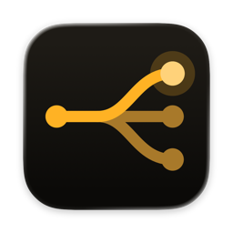

# Switchboard

**Intelligent account routing for Claude Code.**

Running Claude Code on more than one Claude account? Switchboard intelligently routes each new session to the best account, keeps it there while its cache is warm, moves it when a limit hits, and ring-fences client work to its own pool, all automatically.

Simply start `claude` as normal: nothing about how you work changes. Behind it, a live dashboard shows what every account has left and when it resets, Claude can read its own limits and pace its work around them, and every request is kept on record, with what it was worth.

[](LICENSE)
[](https://go.dev)
[](docs/README.md)

[Docs](docs/README.md) · [Pools](docs/pools.md) · [Commands](docs/commands.md) · [Configuration](docs/configuration.md) · [Troubleshooting](docs/troubleshooting.md)

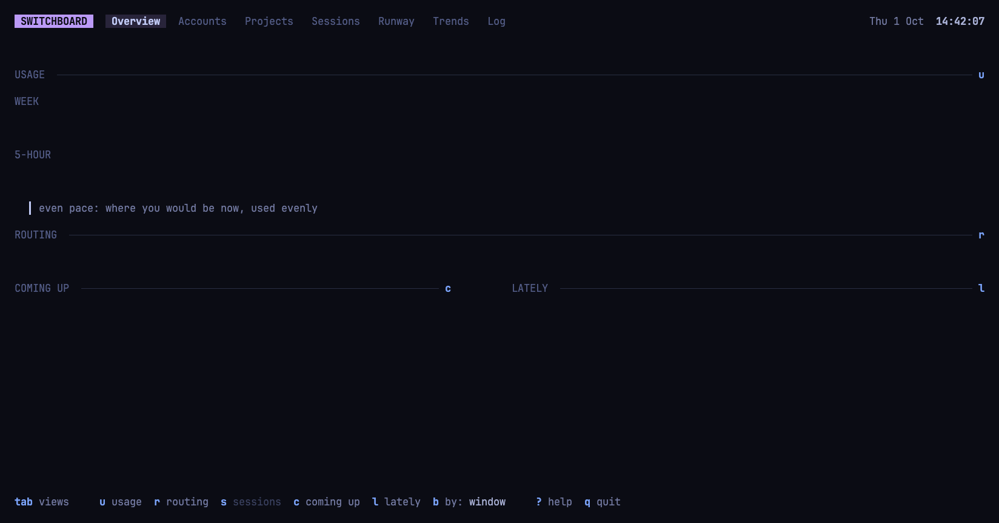

</div>

---

## Why Switchboard?

Every Claude plan has a weekly limit, and many have a 5-hour limit too. When an account hits one,
Claude Code stops. Changing accounts by hand means quitting and signing in again, and the session
resumes on a cold cache.

- **Limits don't end your session.** A request refused at a limit is replayed on another account
  before Claude Code sees the refusal. [Limits and routing](docs/limits-and-routing.md)
- **Client work keeps its accounts.** Fence a pool to `~/Code/acme`, and only sessions started
  there use the accounts in that pool. [Pools](docs/pools.md)
- **Claude paces itself.** Ask Claude to spend what's left before the 08:00 reset without reaching
  100%, and it spreads the work to fit. [Claude and switchboard](docs/claude-and-switchboard.md)
- **See when you'll run out.** Runway, one of seven dashboard tabs, shows when each account runs
  out at your pace and when it has room again. [Runway](docs/dashboard/runway.md)
- **Every request, priced.** The record keeps 400 days of requests, and sets what they'd cost at
  API prices against what your plans cost. [Your record](docs/your-record.md)
- **Resets arrive one at a time.** Give switchboard your working day, and it starts the 5-hour
  window of each account at a different time. [Staggered resets](docs/staggered-resets.md)

Also: [Notifications](docs/notifications.md) · [Room for the Claude app](docs/room-for-the-claude-app.md) · [Pinning and moving](docs/pinning-and-moving.md) · [Several Macs and backups](docs/several-macs.md)

**With one account,** everything but the replay still works, because a replay needs a second
account to move to.

## Screens

|  |  |
|:---:|:---:|
| <a href="docs/dashboard/overview.md">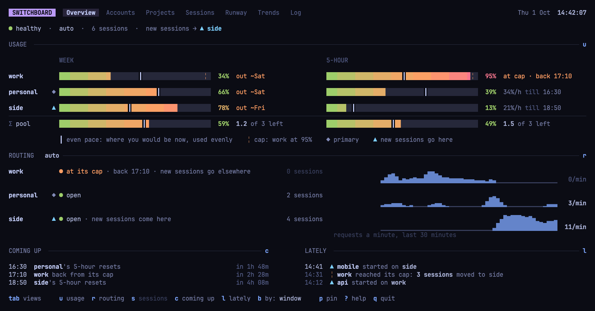</a><br>**Overview**<br>Where every account stands right now | <a href="docs/dashboard/accounts.md">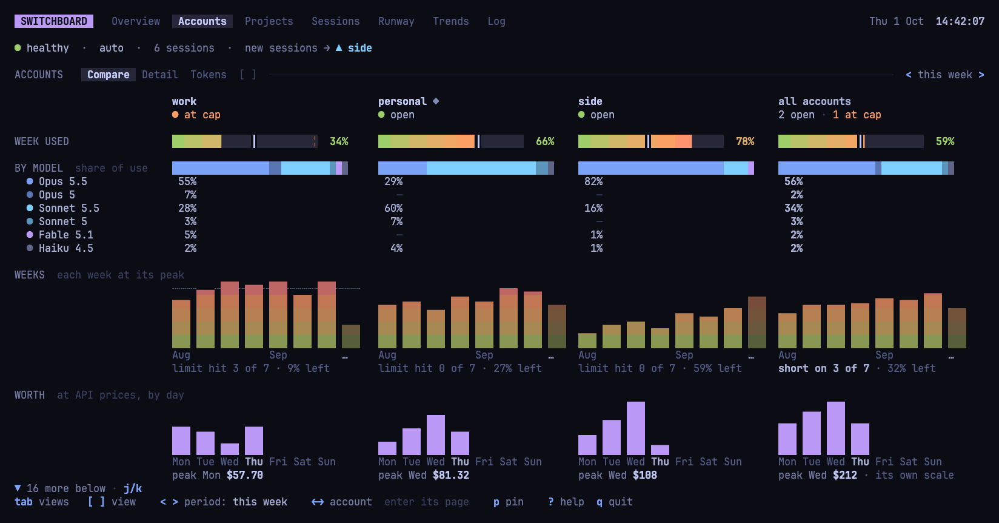</a><br>**Accounts**<br>How the accounts compare, side by side |
| <a href="docs/dashboard/projects.md">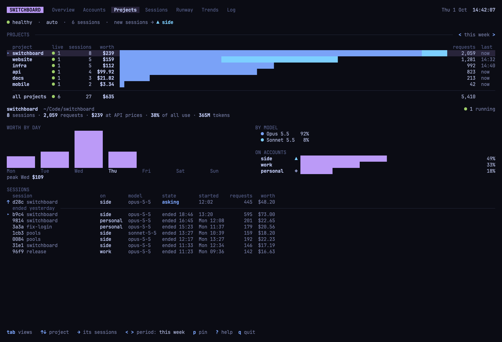</a><br>**Projects**<br>Where your use went, project by project | <a href="docs/dashboard/sessions.md">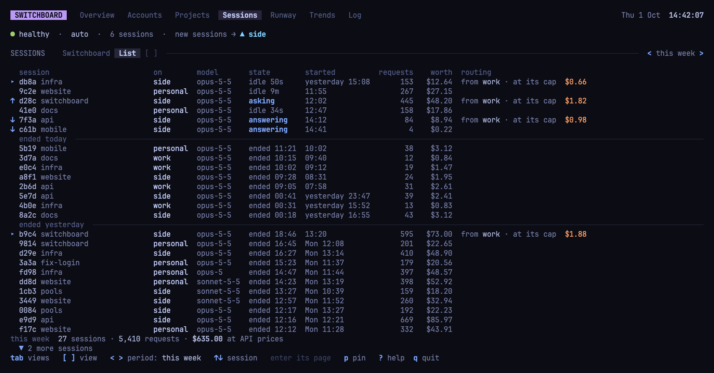</a><br>**Sessions' List**<br>Every session of the period, in one list |
| <a href="docs/dashboard/trends.md">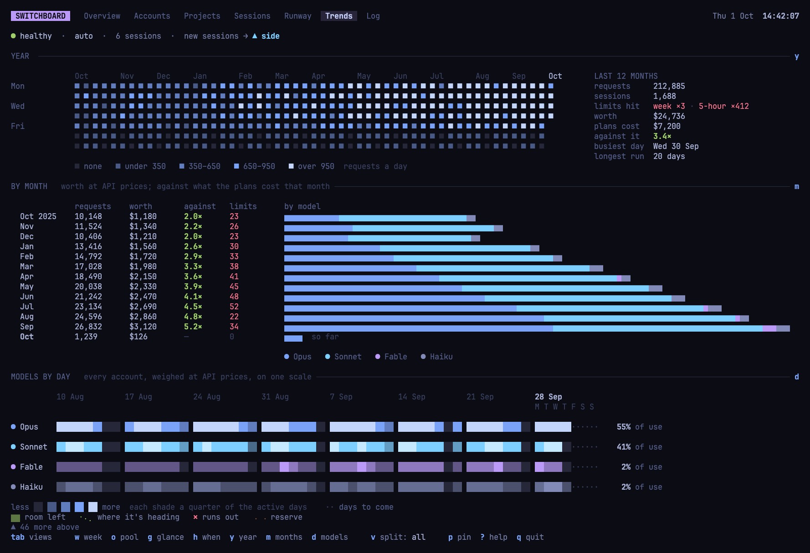</a><br>**Trends' year**<br>How your use has gone over the year | <a href="docs/dashboard/sessions.md">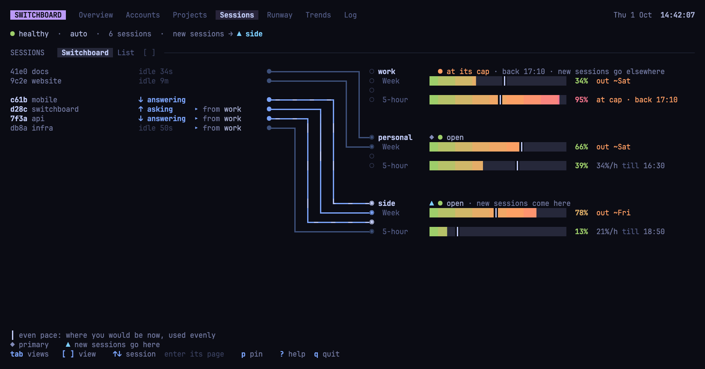</a><br>**Sessions**<br>Which account each session is on |
| <a href="docs/dashboard/runway.md">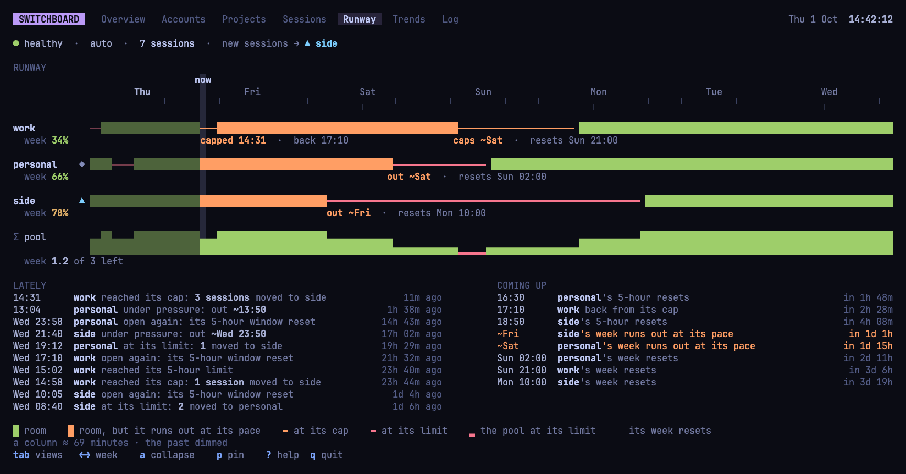</a><br>**Runway**<br>When each account has room | <a href="docs/dashboard/trends.md">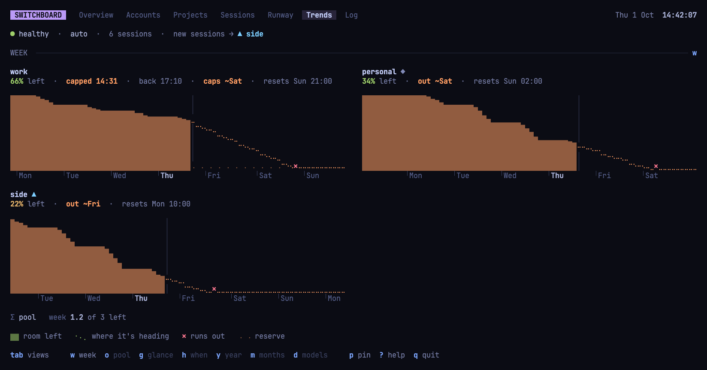</a><br>**Trends**<br>Where each week is heading, account by account |
| <a href="docs/dashboard/log.md">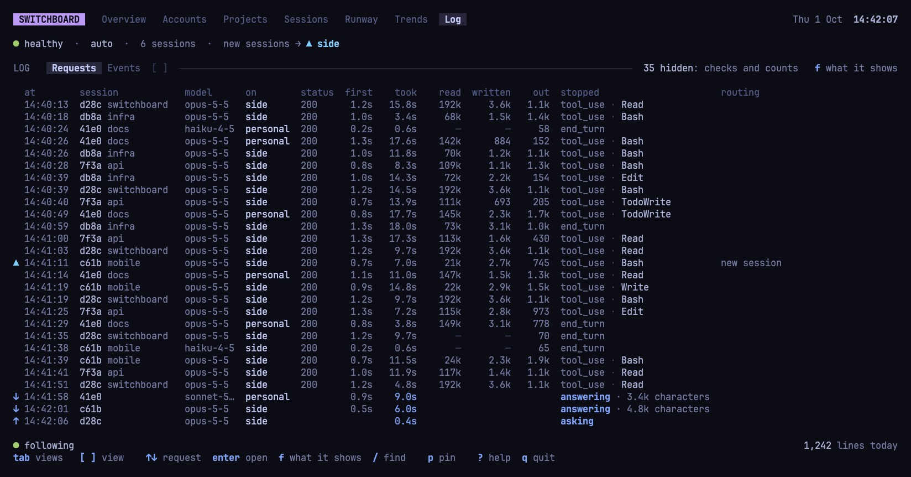</a><br>**The Log**<br>What the router did, request by request | <a href="docs/dashboard/session-page.md">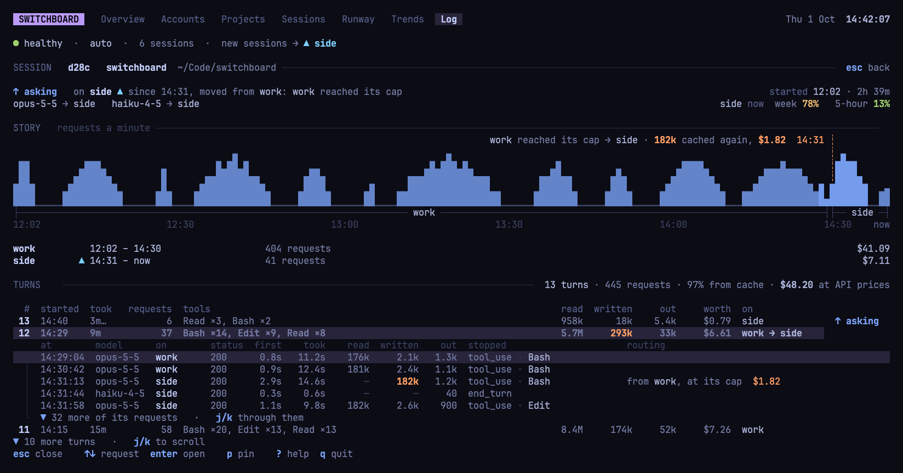</a><br>**A session's page**<br>One session, from start to exit |
| <a href="docs/dashboard/themes.md">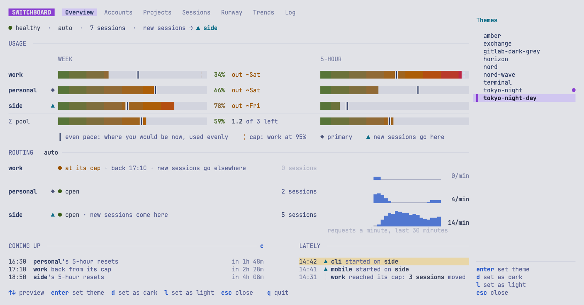</a><br>**Themes**<br>Nine built in, or your own | <a href="docs/dashboard/phone.md">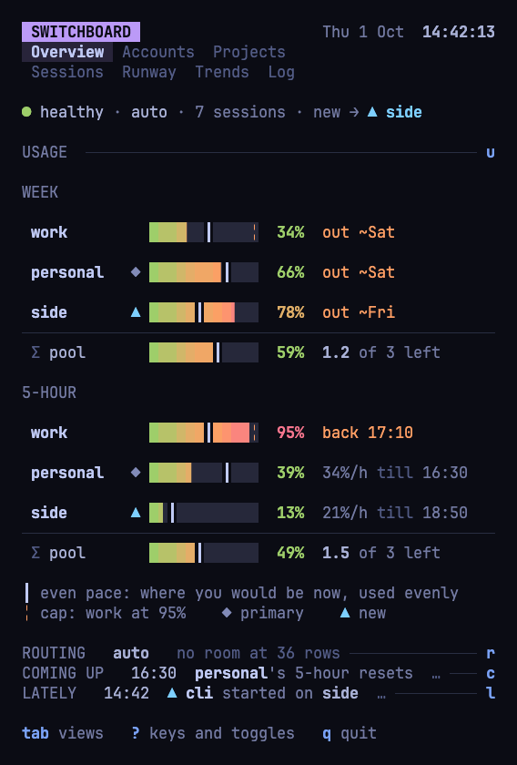</a><br>**On a phone**<br>Every tab laid out for a narrow screen |

## Install

You need macOS, Claude Code, and one or more Claude accounts.

```bash
brew install leeovery/tools/switchboard
```

Or, with Go 1.27 or later:

```bash
go install github.com/leeovery/switchboard/cmd/switchboard@latest
```

To remove it, run `switchboard uninstall`, then `brew uninstall switchboard`. Your config, tokens
and record stay for a reinstall unless you add `--all`. See [Commands](docs/commands.md).

## Quick start

```bash
# Add your accounts and install the rest
switchboard setup
# Start Claude Code, routed
claude
# See what every account has left
switchboard usage
# Open the live dashboard
switchboard dashboard
```

`setup` walks you through each step full screen, and makes the token for each account with
`claude setup-token` as it goes.

**Upgrading?** Run `brew upgrade switchboard`. The router restarts into the new version by itself
once no request is in flight. If it can't, see [Troubleshooting](docs/troubleshooting/upgrades.md).

## Questions you may have

- **Does it read my conversations?** No. It records each request without the content, and never
  edits a request body. [Your record](docs/your-record.md)
- **What if switchboard stops?** By default, `claude` says the router is down and doesn't start.
  Set `when_router_down = "direct"` to start without it. [Configuration](docs/configuration.md)
- **Does moving a session cost me?** A move starts on a cold cache, so a session stays on its
  account while the cache is warm. [Limits and routing](docs/limits-and-routing.md)
- **Can I still use the Claude app?** Yes. Give an account a reserve, and the router leaves that
  share of every window for you. Only a pin you set, or a session started without the router,
  spends it. [Room for the Claude app](docs/room-for-the-claude-app.md)
- **Is it macOS only?** Yes, for now. [How it works](docs/how-it-works.md)

## Where next

- [The docs](docs/README.md): every page, by task.
- [Commands](docs/commands.md): every command and flag.
- [Configuration](docs/configuration.md): every config key.
- [Troubleshooting](docs/troubleshooting.md): what to check when something's wrong.

Working on switchboard itself? Start with [CONTRIBUTING](CONTRIBUTING.md).

## License

MIT
