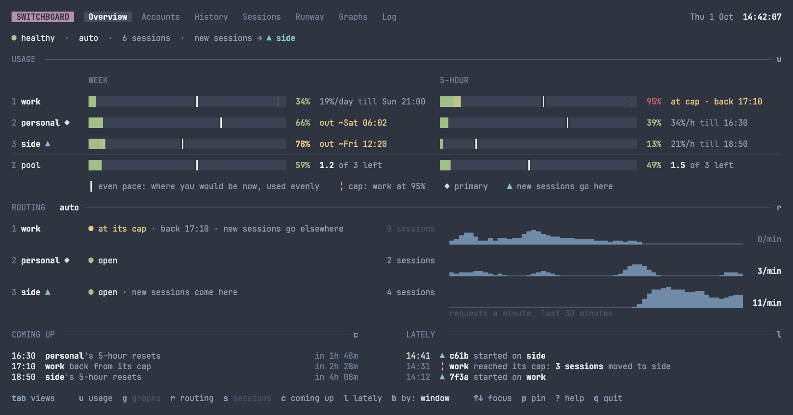
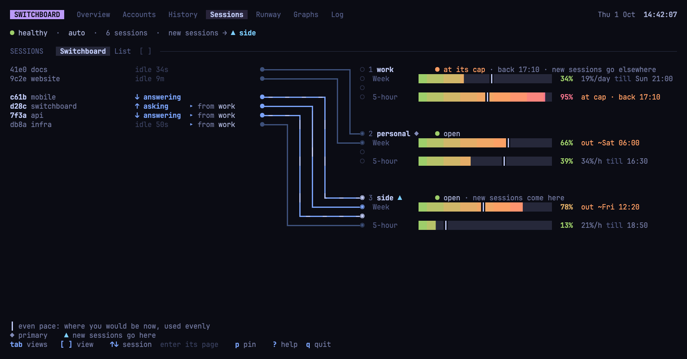
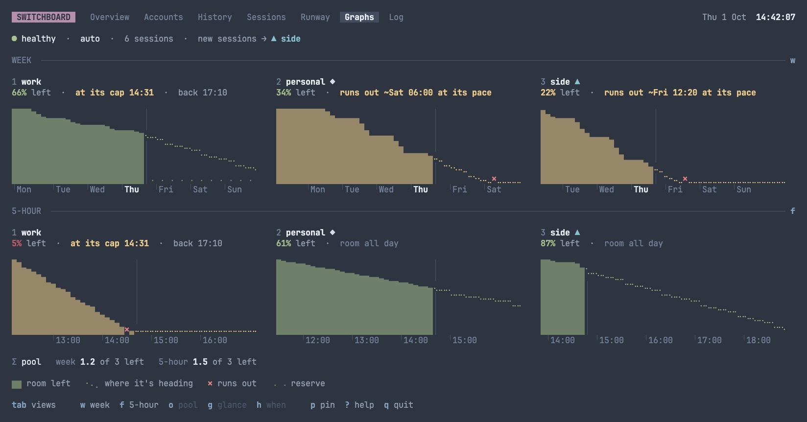
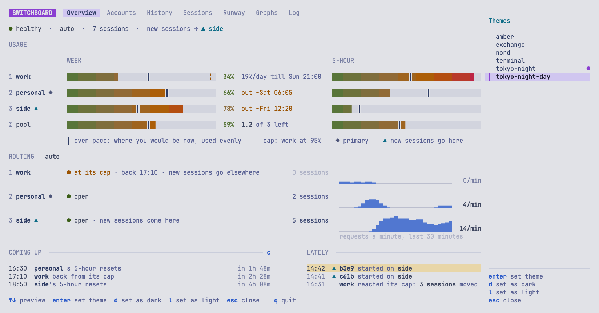

<div align="center">

# 🎛️ Switchboard

**Automatic account routing for Claude Code**

Switchboard is a local router for Claude Code. With more than one Claude subscription, it picks the best account
<br>for each new session, and when a request hits a limit it replays it on another account, so the session carries on
<br>without restarting. On one account or several, it records every request, so you and Claude can see how much
<br>of each limit is left, how fast it's going, and when it resets.

[](LICENSE)
[](https://go.dev)
[](#install)

[Install](#install) · [Quick start](#quick-start) · [Screens](#screens) · [How it works](#how-it-works) · [Commands](#commands) · [Documentation](#documentation)

<br>



</div>

---

## Why Switchboard?

Every Claude subscription has a 5-hour limit and a weekly one, and when you hit one, Claude Code stops. Claude can't see the limits coming, and switching accounts by hand means quitting, resuming and starting again with a cold prompt cache.

- **Limits stop interrupting you.** A request that hits a limit is replayed on another account before Claude Code sees it, and the session carries on.
- **No quota goes to waste.** New sessions go to the account whose weekly quota is most at risk of going unused.
- **Claude sees its own limits.** A skill lets Claude read every account's usage, pace and resets, and plan its work around them.
- **Sessions stay put.** A session keeps its account while its prompt cache is warm, and moves only when it must.
- **Resets come one at a time.** Switchboard staggers your accounts' 5-hour windows, so when they're all spent, one is back soon.
- **Every request on record.** Kept for a year, so you can follow any session and see what your use was worth at API prices against what your plans cost.
- **Your usage, always in view.** A live dashboard shows what's left in each window, when you'll run out at your pace, and when it resets.
- **You and Claude both steer.** Pin new sessions to an account, or move running ones, from the command line, the dashboard, or by asking Claude.
- **Told in time.** Desktop notifications when an account hits a limit, has room again, passes a share you set, or its token nears the end of its year.
- **Never in the way.** If switchboard can't route a session, `claude` starts as it would without it.

**Worth it with one subscription.** Claude paces its work on your live usage and your history, every request goes on record, and the dashboard shows where you stand. The router carries every request on that one account; a session that hits a limit has nowhere else to go until you add a second.

## Screens

|  |  |
|:---:|:---:|
| <a href="docs/dashboard.md#overview"></a><br>**Overview**<br>Every account's usage, and how the router stands | <a href="docs/dashboard.md#accounts"></a><br>**Accounts**<br>Each account in depth, side by side |
| <a href="docs/dashboard.md#history"></a><br>**History**<br>How your use has gone over the year | <a href="docs/dashboard.md#sessions-1"></a><br>**Sessions**<br>Where each session's requests are going |
| <a href="docs/dashboard.md#runway"></a><br>**Runway**<br>When each account has room | <a href="docs/dashboard.md#graphs"></a><br>**Graphs**<br>Every account's burn-down at a glance |
| <a href="docs/dashboard.md#the-log"></a><br>**The Log**<br>Every request and router decision, live | <a href="docs/dashboard.md#a-sessions-page"></a><br>**A session's page**<br>One session's whole story |
| <a href="docs/dashboard.md#themes"></a><br>**Themes**<br>Six built in, or your own | <a href="docs/dashboard.md#on-a-phone"></a><br>**On a phone**<br>Every page laid out for a narrow screen |

Each screen opens its page in [the dashboard's docs](docs/dashboard.md).

## Install

You need macOS, Claude Code, and a long-lived token for each subscription. To make a token, run `claude setup-token` while signed in to that subscription.

```bash
brew install leeovery/tools/switchboard
```

Or, with Go 1.27 or later:

```bash
go install github.com/leeovery/switchboard/cmd/switchboard@latest
```

## Quick start

```bash
switchboard setup       # add your accounts, then the rest
claude                  # Claude Code, through switchboard
switchboard usage       # every account's limits, as they stand
switchboard dashboard   # the live dashboard
```

`setup` takes you through adding your accounts and installing the rest. See [`setup`](docs/commands.md#setup) for what each step does.

## How it works

```
Claude Code ──ANTHROPIC_BASE_URL──▶ switchboard ──▶ api.anthropic.com
                                      │
                                      ├─ chooses the account: sticky per session and model
                                      ├─ swaps in that account's token
                                      ├─ reads every response's usage headers
                                      └─ records the request, and what the router did
```

- **`claude` runs through switchboard.** `setup` links `claude` to switchboard, which starts the real Claude Code connected to the router.
- **Requests pass through unchanged.** The router swaps in the account's token and never edits a request's body.
- **Usage comes from your own traffic.** Every response says how full each window is, so knowing costs next to nothing.
- **Each session gets an account:** the one whose quota most needs using. It keeps that account while its prompt cache is warm.
- **A limit moves the session.** The router replays the request on another account before Claude Code sees the limit.
- **Everything is recorded:** each usage reading, request and router event, in a file a day.

For routing, recording, priming and the rest in detail, see [How it works](docs/how-it-works.md).

## Claude and switchboard

`setup` installs a Claude Code skill that tells Claude what switchboard does. With it, Claude can:

- **Read the limits.** `switchboard status` gives Claude every account's usage, its pace, when it runs out at that pace, and when it resets. Ask Claude to use what's left of this week before it resets at 08:00 without reaching 100%, and it paces its work through the night.
- **Look back.** `sessions`, `requests`, `history` and `events` give Claude your sessions, their requests, your days and what the router did.
- **Steer when you ask.** Claude can pin new sessions to an account, move running ones, or pin its own session.

Run by Claude, these commands print JSON without being asked. See [Claude and switchboard](docs/how-it-works.md#claude-and-switchboard) for more.

## Commands

| Command | What it does |
|---|---|
| [`switchboard setup`](docs/commands.md#setup) | Adds your accounts and installs the rest, a step at a time |
| [`switchboard usage`](docs/commands.md#usage) | Prints every account's windows as they stand |
| [`switchboard dashboard`](docs/dashboard.md) | Opens the live dashboard |
| [`switchboard pin`](docs/commands.md#pin) | Sends sessions to the accounts you name, or back to the router's choice |
| [`switchboard status`](docs/commands.md#status) | Every account's usage as text, and what's holding each back |
| [`switchboard sessions`](docs/commands.md#sessions) | Today's sessions, or one session in full |
| [`switchboard requests`](docs/commands.md#requests) | The requests the router recorded |
| [`switchboard history`](docs/commands.md#history) | Your use by day and week: requests, tokens and worth |
| [`switchboard events`](docs/commands.md#events) | What the router decided and noticed |
| [`switchboard accounts`](docs/commands.md#accounts) | Lists accounts, adds, edits and removes them, and replaces tokens |
| [`switchboard service`](docs/commands.md#service) | Installs, restarts and checks the service that keeps the router running |
| [`switchboard logs`](docs/commands.md#logs) | Shows and follows the logs |

Every command and flag is in [Commands](docs/commands.md).

## Configuration

Switchboard reads `~/.config/switchboard/config.toml`. `setup` and `switchboard accounts` write it for you, and you can edit it yourself:

```toml
[[account]]
id      = "work"
label   = "Work"
primary = true          # the account your browser and the Claude apps are signed in to

[[account]]
id    = "personal"
label = "Personal"

[prime]
day = "08:00-23:00"     # your day: switchboard spreads the 5-hour resets over it
```

Every key is in [Configuration](docs/configuration.md).

## Documentation

- [Dashboard](docs/dashboard.md): every page, its keys, and themes
- [How it works](docs/how-it-works.md): routing, what's recorded, the primary, reserves and priming
- [Commands](docs/commands.md): every command and flag
- [Configuration](docs/configuration.md): every config key, tokens and notifications
- [Reference](docs/reference.md): where switchboard keeps its files, their formats, and the JSON its commands print
- [Troubleshooting](docs/troubleshooting.md): what to check first, and the logs

## Contributing

`CLAUDE.md` has the house rules, and [docs/design.md](docs/design.md) the design. Every change passes the gates:

```bash
gofmt -l .               # must print nothing
go vet ./...
scripts/test-isolated    # every test, race detector on, sandboxed
golangci-lint run ./...
go build ./...
```

- **Tests never touch the real system.** `scripts/test-isolated` runs them in a macOS sandbox, and `internal/testguard` fails any run that reaches the real network, home directory, config or binaries.
- **The pictures here are recorded** from the real dashboard with every seam faked. [demo/README.md](demo/README.md) says how to record them again.

## License

MIT
