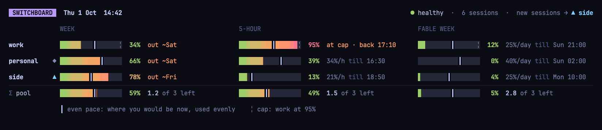

# Claude and switchboard: Claude knows its own limits

Claude can read how much of every account is used, how fast each window is being spent, and when each
resets. So you can ask Claude where a session stands, or to plan a long job around what's left.
`switchboard setup` installs a skill that teaches Claude the commands, so no session needs
switchboard explained.

<p align="center"></p>

*What Claude reads: each window's use, the pace it can spend at, and when it resets or runs out.*

## Try it

In any session started through switchboard, ask Claude things such as these:

```text
Which account is this session on?
How much of this week is left on each account?
Use what's left of this week by its 08:00 reset.
Move this session to side.
```

To answer, Claude runs commands such as these:

```bash
# The label of this session's account, such as work
switchboard status \
  --session "$CLAUDE_CODE_SESSION_ID"
# Every account's windows, as JSON for Claude
switchboard status
# Moves this session to side, named by its id
switchboard pin q4tx \
  --session "$CLAUDE_CODE_SESSION_ID"
```

## What happens

- Claude reads every window from `switchboard status`. It sees how much is used, when the window
  resets, and how much it can spend an hour or a day and still last.
- Claude names accounts to you by their labels, such as `work`, and gives commands the ids.
- When you ask for a long job paced to a reset, Claude works through it by the rate and run-out
  that switchboard reports.
- Claude looks back with `sessions`, `requests`, `history` and `events`. It sees your sessions,
  their requests and what they were worth at API prices.
- When you ask, Claude pins new sessions to an account, moves running sessions there, or moves one
  session only.
- Inside a pool, Claude reads and acts on that pool only. The pool id is in `$SWITCHBOARD_POOL`, and
  the skill has Claude pass it as `--pool`. Outside a pool the variable is empty, and `--pool ""`
  counts as no flag.

## Good to know

- With one account, Claude still paces its work on live usage.
- The skill is a file that switchboard owns, in `~/.claude/skills/switchboard/`. When an upgrade
  brings a new version of the skill, the router replaces your copy as it starts. Any edits you made
  to it are lost. If you remove the skill, it stays removed until you run `switchboard setup` again.
- `setup` also adds a hook that runs as every session starts or resumes. If the session didn't
  start through switchboard, the hook shows you a line saying so. The desktop app and an editor's
  own Claude Code are two such cases.
- Claude isn't told, because a hook message to Claude would go into every prompt of a headless
  `claude -p` run.
- A move costs a cold cache: the first turn on the new account costs about 40 times a warm turn.

## Reference

These are the verbs for agents. Off a terminal, such as in Claude's Bash tool, `status`, `sessions`,
`requests`, `history` and `events` print JSON with no flag. `--pretty` prints the text instead.
`status --session` prints a label unless you add `--json`, and `pin` prints a line of text.

| Command | What Claude gets |
|---|---|
| `switchboard status` | Every account's windows: use, pace, resets, and what holds the account back. |
| `switchboard status --session <id>` | The label of the account the session is on. Add `--json` for JSON. |
| `switchboard status --refresh` | A fresh probe of each account that can take no request, after you reset a limit by hand on claude.ai. |
| `switchboard sessions [<id>]` | Today's sessions, or one session's page with its turns. |
| `switchboard requests` | Today's requests, one JSON object a line. `--since` reaches further back. |
| `switchboard history` | The last 30 days, summed up and priced against the plans. |
| `switchboard events` | What the router decided and noticed: moves, limits, pins and refusals. |
| `switchboard pin <id>` | Sends new sessions to that account. `--move` and `--session` move running ones. |

Each command prints what the matching dashboard view draws, built by the same code, so the two
never disagree. Every flag is in [Commands](commands.md), and every JSON field is in
[Reference](reference.md). If a session says it isn't going through switchboard, see
[Troubleshooting](troubleshooting/claude-link.md).

## Related

- [Pinning and moving](pinning-and-moving.md): what a pin does, and when it gives way.
- [Your record](your-record.md): what `requests`, `history` and `sessions` read back.
- [Limits and routing](limits-and-routing.md): how the router picks an account for each session.
