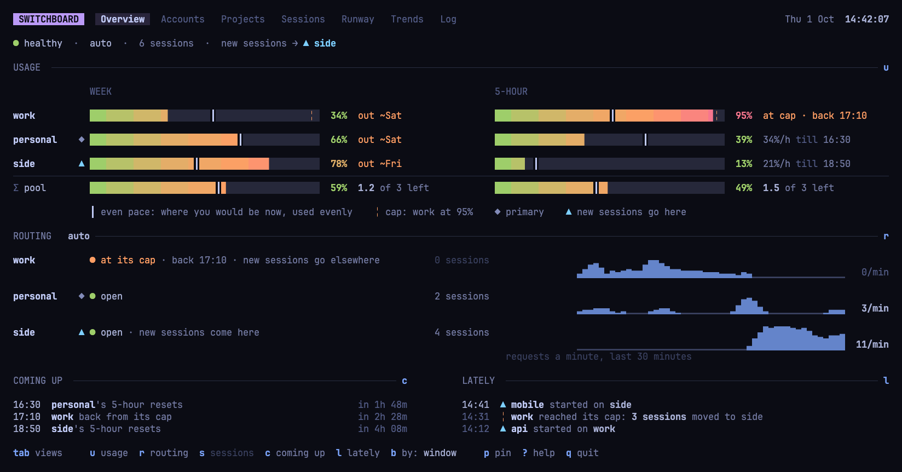

# `switchboard dashboard`: your accounts, live, full screen

`switchboard dashboard` shows the usage of the accounts in one pool, full screen, on seven tabs,
until you press `q`. With one pool, that's every account. For the tabs, the keys and what each
part means, see [Dashboard](../dashboard.md).

```bash
switchboard dashboard
```

<p align="center"></p>

*The dashboard opens on the tab it showed last, here the Overview.*

## Usage and flags

```bash
switchboard dashboard [interval] [--no-notify] [--probe] [--pool <id>]
```

| Flag | Default | What it does |
|---|---|---|
| `interval` | `30m` | How often the dashboard probes every account when it probes for itself: without the router, or with `--probe`. Give a duration, such as `15m` or `1h`, or a number of minutes. The least is `5m`. |
| `--no-notify` | | Posts none of the desktop notifications the dashboard posts while it probes without the router. See [Notifications](../notifications.md). |
| `--probe` | | Probes every account each interval, even while the router runs. Without a router reading there's no routing card, and `p` does nothing. |
| `--pool <id>` | the pool the verbs act on | Shows the pool with that id, as `switchboard pool` lists them. |

The dashboard needs a terminal, and refuses to run without one.

## How it reads usage

| If | The dashboard |
|---|---|
| The router answers | Reads the view of the router every 5 seconds, which costs nothing upstream. The router reads idle accounts itself, each one nothing has read in the last 5 minutes. `R` has it read them at once. |
| The router stops answering | Keeps the last view on screen, and says `■ the router isn't answering  ·  since 14:40:55`. That lasts until the router answers, or until the next probe of its own. |
| There's no router, or you gave `--probe` | Probes every account each interval, and sooner after a window resets or a read fails. It goes back to the router once the router answers. |

## Choosing the pool

The dashboard shows one pool. Without `--pool`, it's the only pool, or else the unfenced pool. The
folder you run it in never chooses. Press `P` to turn to the next pool.

- **A pool the config doesn't have is refused,** a removed one included, because it has no
  accounts to show. The dashboard names the pools there are.
- **If every pool is fenced and you name none,** it opens on no pool, saying it couldn't read usage
  because every pool is fenced. `P` turns to the first pool.
- **A router from before pools** isn't read as the router of one pool. The dashboard probes the
  accounts of the pool instead, and says to run `switchboard service restart`. `p` refuses until
  then.

See [Pools](../pools.md) for what each tab shows in a pool.

## After an upgrade

Just after an upgrade that moves your history, onto account ids or onto pools, the dashboard waits
for the router to finish the move. It prints a line each time what the move waits on changes, and
opens once the move is done.

## Examples

```bash
switchboard dashboard               # probing every 30 minutes without the router
switchboard dashboard 15m           # every 15 minutes
switchboard dashboard --probe       # every account from the API each interval, whatever the router says
switchboard dashboard --pool q7mt   # pool q7mt
```

## Related

- [Dashboard](../dashboard.md): every tab, key and mark.
- [usage](usage.md): the same windows, printed once.
- [Pools](../pools.md): turning between pools with `P`.
