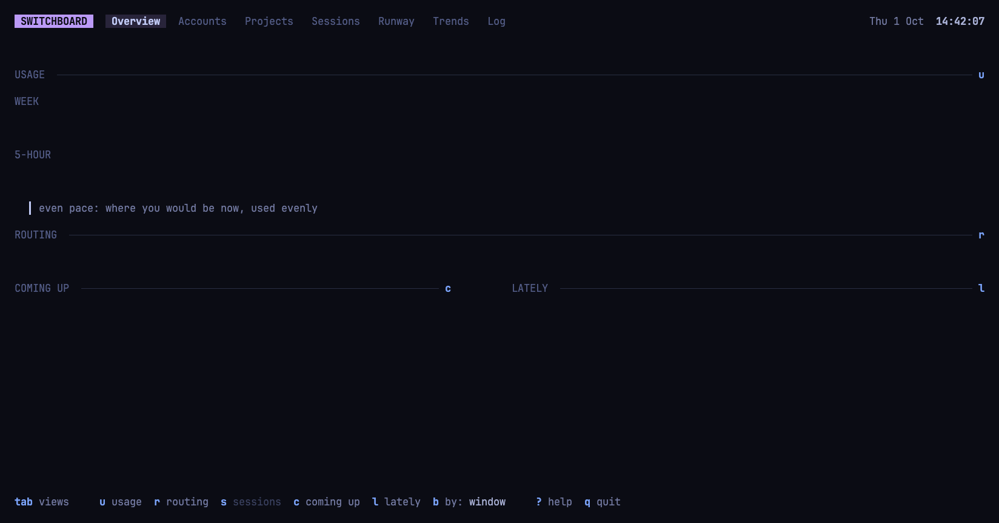

# Dashboard: your accounts, live, on one screen

The dashboard keeps the usage of every account on screen and redraws it as requests arrive. You see
which account takes new sessions, which is near a limit, where each session runs, and what your use
was worth. It has seven tabs, and a page for each session.

```bash
switchboard dashboard
```

<div align="center">

</div>

*A tour of the tabs, from the Overview to Accounts.*

With several pools, the dashboard shows one pool at a time, and `P` turns to the next. The flags
are on the page for [`switchboard dashboard`](commands/dashboard.md).

## The tabs

- [Overview](dashboard/overview.md): the windows of every account, and how the router stands
  with each.
- [Accounts](dashboard/accounts.md): each account in depth, and all of them together, over a
  period.
- [Projects](dashboard/projects.md): where the use went, project by project.
- [Sessions](dashboard/sessions.md): which account each session is on now, and every session of
  the period.
- [Runway](dashboard/runway.md): when each account has room, over the week.
- [Trends](dashboard/trends.md): the shapes of use over time, as charts.
- [The Log](dashboard/log.md): the router's requests and events, as they happen.
- [The session page](dashboard/session-page.md): one session, through its whole life.

## Across the tabs

- [Every page](dashboard/every-page.md): the frame, the status line, help, the key line, clicks,
  and the keys every page shares.
- [The routing card](dashboard/routing-card.md): where new sessions go, set from the dashboard.
- [On a phone](dashboard/phone.md): how each tab lays itself out on a narrow screen.
- [Running it](dashboard/running-it.md): one pool at a time, what changes when the config does,
  and what the dashboard remembers.
- [Themes](dashboard/themes.md): the built-in themes, the picker, and your own.
