# Dashboard

The dashboard keeps every account's usage on screen, live. It has six tabs and a page for each
session, and shows the router's sessions and its record of every request. To open it, run
`switchboard dashboard`.

- [Terms](#terms)
- [Overview](#overview)
- [Accounts](#accounts)
- [History](#history)
- [Sessions](#sessions)
- [Runway](#runway)
- [The Log](#the-log)
- [A session's page](#a-sessions-page)
- [On a phone](#on-a-phone)
- [Every page](#every-page)
- [Running it](#running-it)
- [Keys](#keys)
- [The routing card](#the-routing-card)
- [The key line](#the-key-line)
- [Clicks](#clicks)
- [What's remembered](#whats-remembered)
- [Themes](#themes)

## Terms

This page uses these terms throughout:

- **Window:** a span Claude counts an account's usage over. Each account has a 5-hour window, a
  week that every model shares, and a model's own week where the model has one.
- **Limit:** Claude's own limit on a window. An account at a limit can't take the requests that
  limit counts until it lifts.
- **Cap:** the point where an account's reserve starts, 1 less its `reserve`. The router passes
  over an account at its cap. See [Reserves](how-it-works.md#reserves).
- **Pool:** the accounts new sessions can go to now. That's every account on auto, or only the
  pinned accounts while a global pin holds.
- **Pin:** your choice of where sessions go, set with the routing card or with
  [`pin`](commands.md#pin).
- **The primary:** the account your browser and the Claude apps are signed into. See
  [The primary](how-it-works.md#the-primary).
- **Worth at API prices:** what the same tokens would have cost through the API.

## Overview

The **Overview** shows every account's windows and how the router stands with each. It fits on
one screen that never scrolls.

<div align="center">
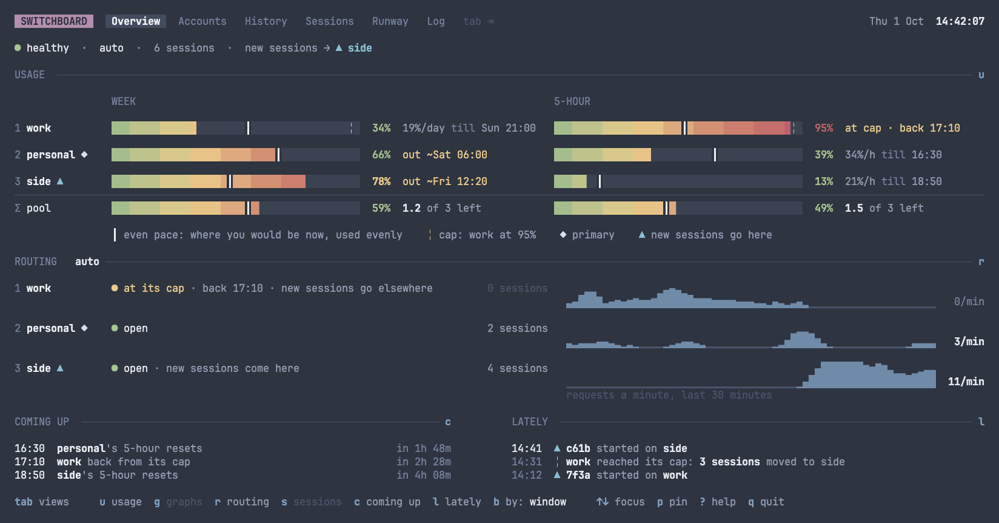
</div>

### Sections

The Overview has six sections, always in this order. Each key shows or hides its section, at any
size.

| Section | Key | At first |
|---|---|---|
| USAGE | `u` | shown |
| GRAPHS | `g` | hidden |
| ROUTING | `r` | shown |
| SESSIONS | `s` | hidden |
| COMING UP | `c` | shown |
| LATELY | `l` | shown |

The terminal's size never decides which sections show. It decides only how much room each section
gets:

- When rows run short, sections fold to their headings. Each folded heading still says what the
  section holds.
- Before a section folds, USAGE's accounts close up, the blank row between each two giving way.
  They close up only where that keeps a section open.
- Sections fold in this order: SESSIONS first, then COMING UP and LATELY, then GRAPHS, then
  ROUTING.
- USAGE never folds. Short of its rows, with every other section folded, it shows as many
  accounts as it can: its accounts close up, then the blank rows under its headings give way,
  then its key, as far as shows the most, and where they still don't fit, it scrolls within
  itself.
- A folded section opens again wherever it fits, the last folded first.
- Spare rows grow the sections that aren't folded, up to their full size, even while others are
  folded. SESSIONS takes them first, a whole session at a time.

### USAGE

USAGE is the block that [`usage`](commands.md#usage) prints: every account's windows, and the
pool's.

- From 150 columns, it's the matrix. Given the room, it stacks the windows at the full width
  instead, their bars as long.
- Narrower, it stacks the windows as `usage` stacks them.
- An account out of the pool, under a pin, is drawn faint.

Each model's own window, such as Fable's week, is hidden until you press `w`. That goes for every
view that shows the windows as they stand now: USAGE, GRAPHS, Accounts' Detail, Sessions'
Switchboard and a session's page. A hidden window still shows while it nears its limit on any
account: at the limit, at the cap, running out, or within 10 points of running out. `usage`,
History and the Log always show every window.

The key line under the block names the marks:

| Mark | Means |
|---|---|
| `┃` | even pace |
| `╎` | the cap |
| `◆` | the primary |
| `▲` | where new sessions go |

Where the key line has no room for `▲ new sessions go here`, it says `▲ new`. With one account,
which has no pool, USAGE's heading says the room it has left in each window, wherever the heading
has room for it.

### GRAPHS

GRAPHS charts the focused account's windows, one chart a window, running from the window's start
to its reset. Where every chart fits under USAGE's bars, each sits under its window's column;
narrower, they start at the left edge, as many side by side as fit, the rest on the rows under.
`v` flips between two charts, and the dashboard remembers which:

- **The burn-up** fills with the use so far, and shows the window's cap, even pace and now.
- **The burn-down** falls from full as the room is used. A dotted line heads on from now at the
  window's pace: to a `✕` on the floor where the window runs out, or to the room it will have left
  at its reset. The cap is a faint dotted line along its floor, and a window held at its limit
  draws a line along the floor until it lifts.

`↑` and `↓` move the focus between accounts. USAGE lights the focused account.

By account, from 150 columns, GRAPHS draws every account's charts beside its block instead: as
many of its windows as fit side by side, and with rows to spare, every one, the rest under them,
taller as the rows allow. There's no focus to move. Beside `Σ pool`, the pool's charts show
the room its accounts had left over each window's length back to now, each to its cap, summed, as
Runway judges how each stood: one held back from every request counts none of its 5-hour window.
Each account's reset shows as a step up. Narrower, and on a phone, GRAPHS charts the focused
account under USAGE.

<div align="center">
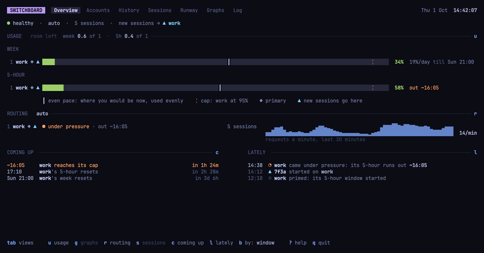
</div>

The animation shows one account, `work`, alone on the Overview, with its usage, its routing trace
and LATELY. Then `g` shows GRAPHS, `tab` moves on to Runway, and `>` to its 5-hour view. There, work's lane
runs out at its pace to its cap, and is back at 17:10.

### ROUTING

ROUTING says, in words, how each account stands with the router. For example:

- `● under pressure · out ~16:05`
- `■ limit reached · back 15:54`
- `○ idle · window starts at its prime, 16:20`
- `● pinned`, on each account the pin names, where it has room beside the account's state, and,
  where the state says when it's back or when its pressure runs out, only where that time fits
  beside the mark too. A prime's time gives way to the mark. Where the mark doesn't fit, a
  state that says the pin says it in its words, as `● at its cap · pinned`; otherwise only the
  heading names the pinned accounts.

For each account, ROUTING also shows:

- the account's sessions
- its requests a minute over the last 30 minutes, drawn as a trace, with the last minute's rate.

The section's heading gives the routing mode: `auto`, or
`pinned to personal since 14:02   p back to auto`.

Every trace on the page shares one scale, a session's trace included, so you can compare any two.

### SESSIONS

SESSIONS lists the sessions the router has routed in the last hour, busiest first. The account
whose sessions send the most requests a minute comes first, with all its sessions together, the
busiest of them first. Each session shows:

- its id, bright while the session is busy
- its model
- when it was last seen
- what it's doing, such as `↑ ask` or `↓ ~1.2k`
- why it's on its account, such as `moved from work 14:31: work reached its cap`
- its own trace, lined up with ROUTING's.

SESSIONS shows as many sessions as there's room for, and a row such as `+5 more` for the rest. It
folds only when there isn't room for one session and that row. The sessions it shows stay put
until the layout changes, on a key or a resize: a session that starts joins `+5 more`, one that
ends leaves its row blank, and nothing reorders as the rates change. When every row is already
taken, the last session shown gives way to the `+N more` row. Once every session it kept has
ended, it says `no sessions running`. When none were running as the layout was made, a session
that starts shows on the row where it fits whole, and otherwise is counted in `+N more`.

ROUTING takes a row for each account, and SESSIONS a row for each session, wherever an account's
name, its state in at least 20 cells, its sessions and a trace of at least 24 fit on one row, from
83 columns with a name column of 16. Narrower, each takes two.

### COMING UP and LATELY

COMING UP and LATELY sit side by side where both fit, from 93 columns, and LATELY goes under
COMING UP where they don't.

- **COMING UP** is what happens next, soonest first, such as
  `16:30  personal's 5-hour resets  in 1h 48m`. A run-out's row is in the theme's attention colour.
- **LATELY** is what the router has done, newest first. Each event is marked, such as
  `14:31  ╎ work reached its cap: 3 sessions moved to side`. When a limit, a cap or a refusal moves
  sessions, those sessions are folded into that event's line.

### By account

`b` makes USAGE one block for each account, with the account's windows as rows and its ROUTING
beside it. The pool's block comes last. While GRAPHS shows, from 150 columns, each account's charts
sit beside its block instead, the pool's beside the pool's, and ROUTING is a section of its own
again.

### Keys on the Overview

| Key | Does |
|---|---|
| `u` `g` `r` `s` `c` `l` | Shows or hides a section: USAGE, GRAPHS, ROUTING, SESSIONS, COMING UP and LATELY. |
| `w` | Shows or hides each model's own window, such as Fable's week. They're hidden until you press `w`. `?` lists it; the key line leaves it out. |
| `b` | Groups the windows by window or by account. Until you press `b`, the grouping follows [`[usage] by`](configuration.md#usage-keys). |
| `v` | While GRAPHS shows, flips it between the burn-up and the burn-down. |
| `↑` `↓` | Moves the focus between the accounts, in the config's order. GRAPHS charts the focused account, and USAGE scrolls to it. While GRAPHS charts every account beside USAGE, there's no focus to move. |

## Accounts

**Accounts** shows each account in depth, and every account together. It has two views on
sub-tabs, Compare and Detail, and `[` and `]` move between them. With one account, Accounts shows
Detail alone, and `[` and `]` do nothing there.

<div align="center">
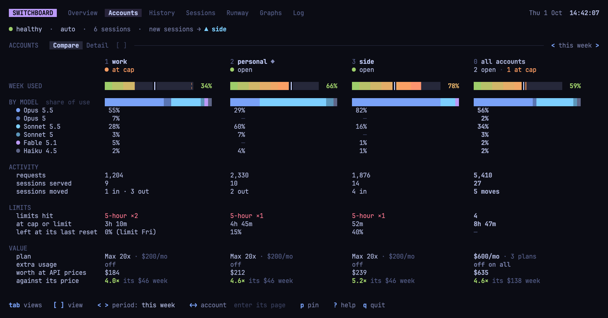
</div>

### Compare

Compare has a column for each account, and one for `all accounts`. Each column shows:

- the account's week, as a bar
- its share of use by model version
- its requests, and the sessions it served and moved
- its limits hit
- the time it spent at its cap or a limit, and what it had left at its last reset
- its plan and its extra usage
- what the plan costs against what its use was worth at API prices. Where an account has no
  `plan`, `all accounts` says how many of the plans it knows, as its worth is every account's.

`←` and `→` move a focus along the columns, scrolling them where they don't all fit. `enter`
opens the focused account in Detail.

### Detail

Detail shows one account, or all of them, chosen from a list at its left. It shows:

- the account's windows now
- the period's requests, limits, plan, worth and extra usage
- its use by model
- the last weeks, six where they fit, as its rule names them, a day and a week at a time
- its verdict, as History's Weeks gives it
- its SESSIONS now
- its LATELY.

In Detail:

- `↑` and `↓` choose the account in the list, `all accounts` first.
- `→` moves into the chosen account's sessions, and `←` goes back to the list.
- In the sessions, `↑` and `↓` choose a session, and `enter` opens its page.

The chosen row is lit only where `↑` and `↓` act, in the list or in the sessions. The other's chosen
row stays bold, marked `▸`, and `SESSIONS` is bright while you're in them. The list widens to fit
the accounts' names where the screen has room, as USAGE's name column does.

### The period

`<` and `>` step to a shorter or a longer period, which both views count over. The periods are
today, this week, 30 days and 12 weeks. They're rolling, never billing months.

## History

**History** shows how use has gone over time. It has four views on sub-tabs: Year, Weeks, Days
and Tokens. `[` and `]` move between them.

<div align="center">
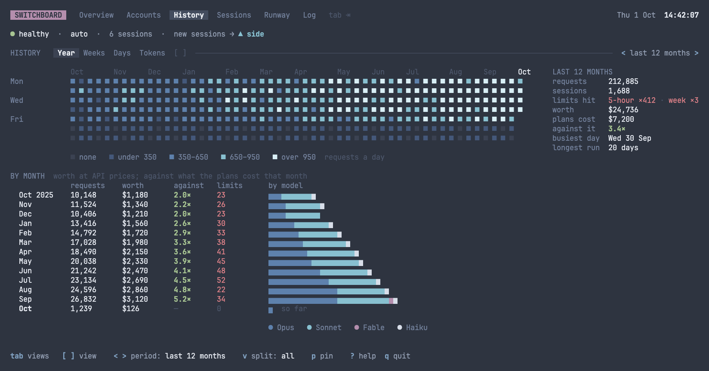
</div>

### Year

Year is the default view. It draws a square for each day over the last 12 months, with a column
for each week.

- Each square is shaded by how many requests the day made, never by its worth.
- A day with nothing on it has a shade of its own. The active days fall into quarters by how much
  each did.

Beside the grid where the width allows, and under the key otherwise, Year shows the 12 months':

- requests, sessions and limits hit
- worth, what the plans cost, and the worth against it
- busiest day and longest run.

Under the squares, BY MONTH has a row for each month. Each row's bar is the month's worth, split by
model family.

Year's keys:

- `v` chooses what Year shows: all use, one model version alone in four steps of its own colour,
  or one account.
- `←` and `→` step to the account before or after, round, while Year shows one account.
- `<` and `>` step back through each calendar year the ledger holds, and forward again to the last
  12 months.

Shown for one version, Year counts each of the version's sessions once. There's one exception. A
day's summary may have been written before the ledger kept a model's sessions by their ids, and the
day's lines may have gone since. For such a day, Year adds the day's count, as nothing tells those
sessions from another day's.

### Weeks

Weeks shows how full each account's own week got over eight weeks. It also says whether there are
as many accounts as the use needs.

- Its verdict is worded as [`history`](commands.md#history) words it.
- The verdict comes from replaying the last 7 whole weeks with one account fewer or one more.
- `v` draws the weeks as columns or as a table, where both fit.

### Days

Days shows the eight weeks a day at a time:

- each model family's worth, a day at a time
- how much of its week each account used each day, with the days it hit a 5-hour limit marked.

### Tokens

Tokens is ccusage's report inside switchboard. It shows each period's tokens by kind, and its worth
at API prices against what its plans cost.

- `<` and `>` set the period each row is: a day, a week or a month.
- `v` splits each period by account, by model, by both, or not at all.

## Sessions

**Sessions** shows where each session's requests are going now. It has two views on sub-tabs, the
Switchboard and the List, and `[` and `]` move between them.

<div align="center">
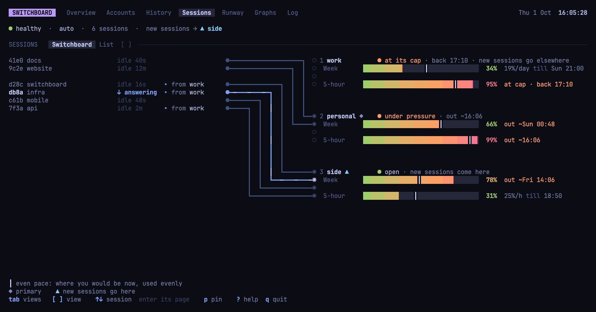
</div>

### The Switchboard

The Switchboard is the default view. It's drawn as a telephone switchboard:

- The sessions run down the left, as calls.
- The accounts run down the right, as lines.
- A cord runs from each call to its account.

Each session's requests travel its cord, out as they go and back as their answers stream. A
refusal bounces back red, `✕ 429`.

When a limit moves a session, the session joins its new account's group. A short cord hangs red
from the old jack, one for each session the limit moved, while the limit holds. A move made for any
other reason hangs faint for 3 seconds.

Where the cords don't fit, as on a phone, each account's line carries its sessions under it. Its
windows are stacked as the board's lines are, a row each, where the screen is tall enough, and go
side by side on one row where it's short. The pool has no lane, as
no session runs on it: the Overview, Runway and `usage` show it.

While the router isn't answering, the Switchboard and the List show the sessions it last listed.
What one was doing then, such as `↓ answering`, stays as it was but faint, here and on every other
tab, as it may have ended since.

### The List

The List is one table of today's sessions: those running first, then those ended. Each row shows
the session's:

- account, model and state
- start time
- requests, and their worth at API prices
- how it came to its account.

### Keys on Sessions

- `↑` and `↓` choose a session: a call on the Switchboard, or a row on the List. Where it's out of
  view, the view scrolls to it.
- `enter` opens the chosen session's page.
- `esc` deselects it.

## Runway

**Runway** shows when each account has room, with a lane for each account.

<div align="center">
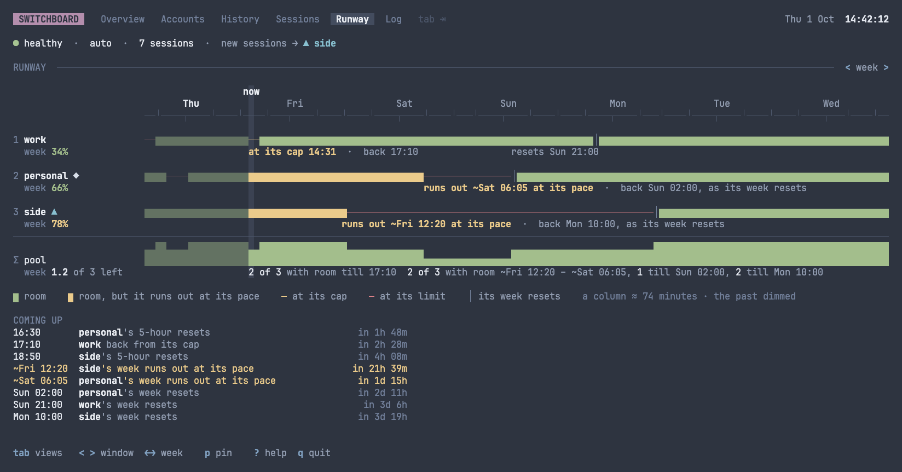
</div>

Runway has two windows, and `<` and `>` switch between them. It opens on the week, and remembers
the one you last left it on:

- **Week:** the week.
- **5-hour:** from the hour before now, for 22 hours 40 minutes.

Each column of a lane is one cell, showing room, at its cap, or at its limit. The past is dimmed.

Words under a lane say where a stretch without room starts and when the account is back. For
example, `at its cap 14:31  ·  back 17:10`, or `runs out ~16:05 at its pace`. Where one hold runs
straight into another, the first says when it lifts, and only the last says when the account is
back: `at its limit 14:00  ·  lifts 19:00  at its cap 14:00  ·  back Mon 21:00`.

With more than one account, the pool's lane sits under the others. It shows how many accounts have
room, a column at a time, and draws a low red bar along its foot where none has. `Σ pool` names
it, as an account's name heads its lane, with the pool's room in the view's window under it, such
as `week 1.2 of 3 left`.

COMING UP sits under the pool's lane and lists what happens next, soonest first, in two columns
on a wide screen. Where its lines don't all fit, its last says how many more, such as `▼ 3 more`.
The legend sits at the foot, over the key line. On a short screen, as with a phone's keyboard up,
COMING UP is cut to the lines that fit first; then the legend gives way, then COMING UP, then the
blank row under the axis; only then do the lanes scroll with `j` and `k`, down to one lane over
the pool's lane at the shortest.

The labels beside the lanes take as many columns as the widest needs, up to 24, and the lanes take
the rest. `a` collapses the labels, to give the lanes more room: each lane keeps its account's
number and its marks, such as `2 ◆`, with its use under them, such as `66%`, and the pool's lane
`Σ`, with its room short under it, such as `1.2/3`. COMING UP stays as it is, each line naming its
account. `a` again expands them. Runway remembers which you left it on.

To look back:

- In the 5-hour view, `←` goes back to today, then a day at a time.
- In the week view, `←` goes back to this week, then a week at a time.
- `→` steps forward, on to the live view.

A step back is never kept.

## The Log

**The Log** shows the router's traffic, as it happens and back through the days. It has two
tables under one tab, Requests and Events, and `[` and `]` move between them. The newest line is at
the foot.

<div align="center">
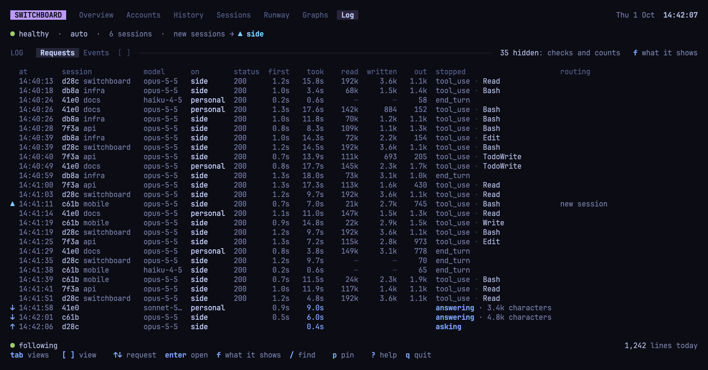
</div>

### Requests

Requests has a line for each request the router routes. Each line shows:

- when the request was made
- its session, model and account
- its status
- how long it took
- its tokens by kind
- why its answer stopped
- how the router chose its account, with a move's cost.

`f` can show more columns:

- worth at API prices
- input tokens
- attempts
- size, messages, tools and thinking budget
- the client that sent the request
- the router's id for the request.

`f` can also show Claude Code's quota checks and counts of tokens. These stay hidden until you
choose them, as neither is work done for you.

### Events

Events has a line for each thing the router decides or notices. Every move the router makes is
there, with why.

### Keys on the Log

| Key | Does |
|---|---|
| `↑` `↓` | Chooses a line. `↑` while following chooses the newest line and pauses the table. With a line's details open, moves to the line before or after. |
| `end` | Follows again: the newest line at the foot, and nothing chosen. |
| `enter` | Opens the chosen line's details. |
| `s` | Opens the page of the chosen line's session. Does nothing on an account's event. |
| `g` | On the details of an event, shows the Requests, paused at the event's moment. |
| `f` | Opens a panel that sets what the Log shows: its columns, and which lines. |
| `/` | Finds a session by the start of its id or its directory's name. |
| `esc` | With a filter on and nothing open, clears the filter. |

In the `f` panel:

- `←` and `→` move between its sides.
- `↑` and `↓` move through a side's ticks.
- `space` ticks the one the cursor is on.
- `enter` applies the ticks, and `esc` closes the panel unchanged.
- `/` closes the panel for the find.

The find looks at today's sessions first, then back a day at a time. `↑`, `↓` and `enter` pick a
session, filtering both tables to it.

## A session's page

**A session's page** follows one session through its whole life.

<div align="center">
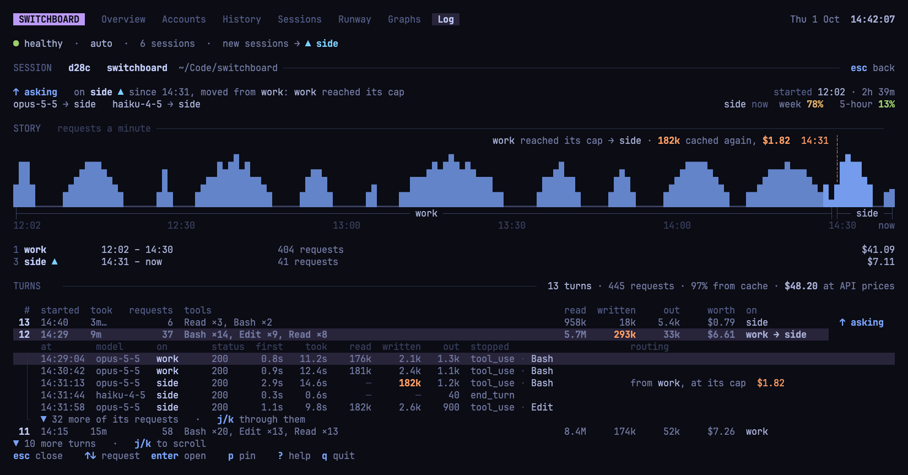
</div>

The page shows:

- what the session is doing now, and where it runs
- its STORY: its requests a minute, from its first to now, with each move marked and costed
- the accounts it ran on, and what it took of each, their worth adding up to its turns', to the
  cent
- its turns, newest first.

To open a session's page, do one of these:

- Press `enter` on a session's row on Sessions, or on Accounts' Detail.
- Press `s` on a line of the Log.
- Click a row of the Overview's SESSIONS.

A session's page opens over a tab. `esc` goes back to where you opened it from, with the tab as you
left it.

A session that has run for weeks takes a moment to read. While it does, the page shows its heading
with `loading…` after it, and `esc` goes back.

A turn's requests are read from the ledger as you open it. If that takes a moment, the turn's foot
says `loading…` until they're read.

Keys on a session's page:

| Key | Does |
|---|---|
| `↑` `↓` | Chooses a turn, or with a turn open, a request of it. |
| `enter` | Opens the chosen turn into its requests, in place. With a turn open, opens the chosen request's details. |
| `esc` | Closes the open turn, or goes back. See [Closing and going back](#closing-and-going-back). |
| `p` | While the session runs, opens the session's own routing card to pin it. See [The routing card](#the-routing-card). |
| `tab` `shift-tab` | Moves to the tab after or before the one the page was opened from. |

## On a phone

Under 100 columns, the dashboard lays itself out for a phone.

<div align="center">
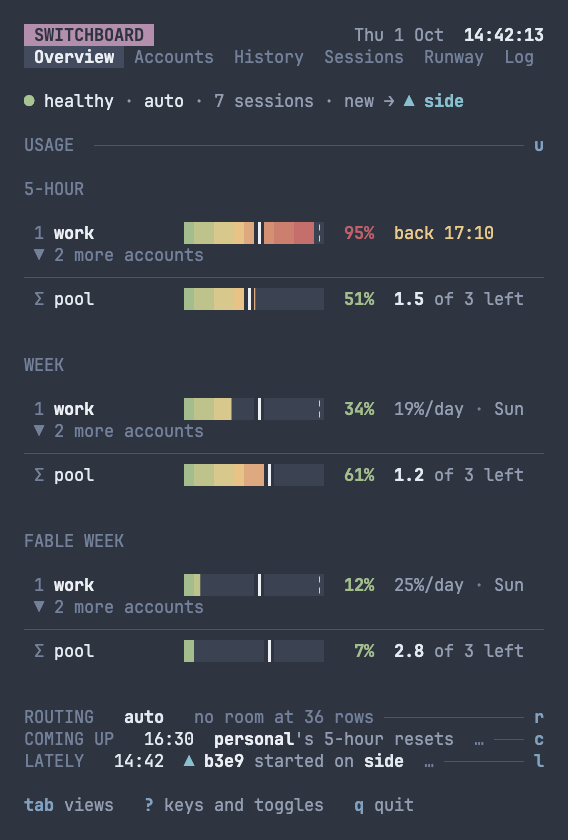
</div>

- The tabs sit on a row of their own, under the clock.
- The Overview's USAGE stacks its windows in short words.
- ROUTING takes two rows for each account, and SESSIONS two rows for each session, as they do
  wherever one row doesn't fit, under 83 columns with a name column of 16.
- LATELY comes under COMING UP, as it does wherever the two don't fit side by side, under 93
  columns.
- Accounts' `against it` and `against` give `all accounts`' ratio alone, but where an account has
  no `plan`, they add how many of the plans it's over, compact: `4.4× · 2/3`.

## Every page

Every page is one frame. From top to bottom, it has:

1. The title row, with the tabs and the clock.
2. The status line.
3. On every tab but the Overview, the tab's heading row: its name and a rule.
4. The view.
5. The key line. See [The key line](#the-key-line).

When a tab reads a lot, as Sessions or the Log first showing a long ledger, its heading row says
`loading…` until the read lands. On the Overview, which has no heading row, SESSIONS' heading says
it. A quick read says nothing. Once the Log, Sessions' List or a session's page has read the
ledger, it keeps reading what the ledger gains while another tab shows, so it's up to date when you
come back to it. The Log keeps only the days it shows: once today's lines fill it, it lets go of
yesterday's, and scrolling back reads them in again.

### The tabs

`tab` and `shift-tab` move between the six tabs, in the title row's order: the Overview, Accounts,
History, Sessions, Runway and the Log. The order goes round, from the Log back to the Overview. The
next dashboard opens on the tab last shown.

### The status line

The status line always says how the router stands, whatever a tab shows. It starts with one of
these:

- `● healthy`
- `■ the router isn't answering  ·  since 14:40:55`, while the router's last view stays on screen
- `○ probed · router not running`.

Then it says:

- how the router routes: `auto` or `pinned to personal`
- the sessions it has routed in the last hour
- where new sessions go: `new sessions → ▲ side`.

### Help

To see every key that works on a page, press `?`. The help card shows:

- every key that works on the page
- what each part of the page shows, and how to read it
- what the page's marks mean.

The card sits over the page. `j` and `k` scroll it a row, and `PgDn` and `PgUp` a page. `?` or
`esc` closes it.

<div align="center">
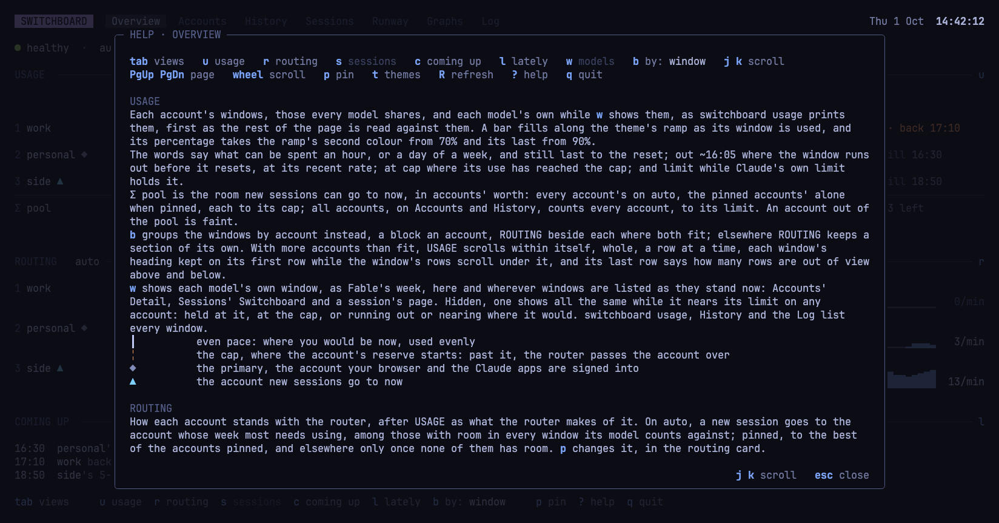
</div>

## Running it

`switchboard dashboard` shows every account's usage, full screen, until you press `q`. It needs a
terminal, and refuses to run without one. It reads the router while the router answers, and
otherwise probes each account.

```bash
switchboard dashboard [interval] [--no-notify] [--probe]
```

The interval, given after the command, is how often the dashboard reads in full:

- It's `30m` unless you give one, and `5m` at the least.
- Give it as a duration, such as `15m` or `1h`, or as a number of minutes.

| Flag | Description |
|---|---|
| `--no-notify` | Posts none of the desktop notifications the dashboard posts while it probes without the router. See [Notifications](configuration.md#notifications). |
| `--probe` | Probes every account each interval, even while the router runs. With no router read, there's no routing card, and `p` does nothing. |

```bash
switchboard dashboard           # reading every 30 minutes
switchboard dashboard 15m       # every 15 minutes
switchboard dashboard --probe   # every account from the API each interval, whatever the router says
```

### How it reads the router

While the router answers:

- The dashboard looks at the router's view every 5 seconds. This costs nothing upstream.
- Every interval, it has the router probe the accounts the router hasn't read in that time. This is
  beside the router's own [rounds](how-it-works.md#priming), every half hour.

If the router stops answering, or a read of it fails, the router's last view stays on screen. The
status line says `■ the router isn't answering  ·  since 14:40:55`. This lasts until the router
answers again, or until the interval's read, or `R`, probes the accounts directly.

Without the router, the dashboard probes every account every interval. It probes sooner after a
window on screen resets, or after an account couldn't be read. It goes back to the router once the
router answers.

## Keys

These keys work on every page. Each page's own keys are under the page:
[Overview](#keys-on-the-overview), [Accounts](#accounts), [History](#history),
[Sessions](#keys-on-sessions), [Runway](#runway), [the Log](#keys-on-the-log) and
[a session's page](#a-sessions-page).

| Key | Does |
|---|---|
| `tab` | Moves to the next tab, in the title row's order and round: the Overview, Accounts, History, Sessions, Runway and the Log. From a session's page, moves to the tab after the one the page was opened from. |
| `shift-tab` | Moves to the tab before. From a session's page, moves to the tab before the one the page was opened from. |
| `[` `]` | On Accounts, History, Sessions and the Log, moves to the sub-tab before or after, round. |
| `p` | Opens the routing card. See [The routing card](#the-routing-card). |
| `R` | Refreshes now. See [Refreshing](#refreshing). |
| `t` | Opens the theme picker. See [Themes](#themes). |
| `?` | Opens the page's help. See [Help](#help). |
| `esc` | Closes what's open, newest first. See [Closing and going back](#closing-and-going-back). |
| `q` | Quits, except while a card, the Log's panel or the Log's find is open: then only their keys act. |
| `ctrl-c` | Quits, wherever you are. |

### Refreshing

`R` has the router probe:

- the accounts it hasn't read in the last minute
- the accounts that can take no request, however lately it read them.

It doesn't probe an account whose 5-hour window has lapsed and that can take a request. It probes
no account twice in a minute. Without the router, `R` probes every account.

### Closing and going back

`esc` closes what's open, the newest first:

- a card
- the theme picker
- the Log's panel
- the Log's find
- a turn opened on a session's page.

With nothing open, `esc` ends a choice. On the Log, with a filter on and nothing open, it clears
the filter. Otherwise, on a session's page, it goes back to where the page was opened from.

### Scrolling

Where a view doesn't fit, these keys scroll it:

| Key | Scrolls |
|---|---|
| `j` `k` | a row |
| `PgDn` `PgUp` | a page |
| the wheel | three rows a turn |

What scrolls on each page:

- **Overview:** USAGE, where its accounts don't fit. It scrolls whole, a row at a time, keeping
  each window's heading on its first row while that window's rows pass under it, and its last row
  says how many rows are out of view above and below.
- **Accounts:** its view.
- **History:** the Year, where the screen is shorter than it; Weeks' accounts; Days' BY ACCOUNT,
  past six accounts; and Tokens' periods.
- **Sessions:** the List, and the Switchboard's accounts where they don't fit.
- **Runway:** its lanes.
- **The Log:** its table.
- **A session's page:** its turns, or with a turn open, the turn's requests.

Weeks, Days, the Switchboard on Sessions, and the lanes on Runway scroll an account at a time.
Tokens scrolls a period at a time. A turn of the wheel scrolls the same.

Where one account or one period doesn't fit, as on a short screen, the view scrolls whole, a row at
a time. It does the same on History's Weeks and Days below 37 rows, and the Year always scrolls
so. It then says how many rows are out of view above and below.

Scrolled a row at a time, a page down starts at the first row the page didn't show, and a page up
ends just above the first row it showed, so paging either way passes over nothing. The
Switchboard's accounts on Sessions page so an account at a time too.

When a resize or what's read turns a view from one kind of scrolling to the other, the view goes
back to its top. Where USAGE is laid out another way, as `b` groups it the other way or a resize
gives it more room or less, it scrolls to show the focused account.

## The routing card

The **routing card** is the only way the dashboard changes routing. It changes nothing until you
press `enter`.

<div align="center">
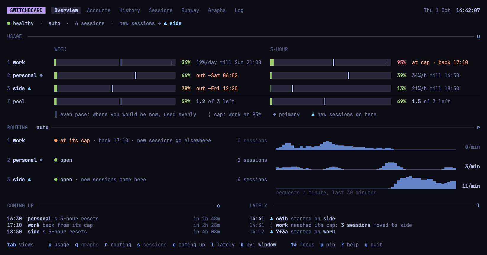
</div>

`p` opens the card over the page. It sets where new sessions go. Nothing is picked but what's set
now. The card has these rows:

- `0 auto`
- a row for each account, numbered by its place in the config.

Each account's row shows:

- whether it's open
- its 5-hour window and week
- why it's closed, such as `at its cap till 17:10`, or its sessions running.

### Picking

- `↑` and `↓` move between the rows, and `space` picks the row the cursor is on.
- A number picks its row directly: `0` picks auto, and `1` to `9` pick the first nine accounts.
  Accounts past the ninth have no number.
- Picking auto clears the accounts, and picking an account clears auto.
- `m` ticks moving the sessions running elsewhere to the picks too. The card then says how many
  sessions would move, and roughly what rebuilding their caches costs, such as `≈ $6.20`.
- Below, a sentence says what the picks do.

An account that can't take a session can't be picked. That's an account at a limit, one whose
token is refused, or one with no token.

### Applying

- `enter` applies the picks, as [`pin`](commands.md#pin) does. The router's event names the
  dashboard as what set them.
- `esc` closes the card with nothing changed.

### When `p` does nothing

- Outside the card, the number keys and `m` do nothing, so a stray key moves no session.
- While the router doesn't answer, `p pin` is drawn faint, and `p` says why instead of opening the
  card.
- With `--probe`, `p pin` isn't listed, and `p` opens nothing, even while the router answers.
- With one account, there's nothing to pin to, and `p` does nothing. The exception is a pin set
  with [`pin`](commands.md#pin) that still stands: then `p` opens the card to clear it.

### A session's own card

On the page of a session that's running, `p` opens that session's own card. Use it to pin the
session to an account, or back to auto. It has no `m`.

### Cards over a page

A card over a page, the routing card or help, is drawn with the page faded behind it. The page
stands still while the card is open, but for the clock, which keeps ticking. The card's own
figures follow each read.

## The key line

The key line, the last row, lists the keys that work on the page. In order:

1. `tab views`, or on a session's page, `esc back`.
2. The page's own keys.
3. `p pin`, where a pin can be set.
4. `? help  q quit`.

A key that can't act now is drawn faint. If you press it, the key line says why, in the line's
place, for 4 seconds.

`t`, `R` and the scrolling keys work everywhere, and are left to `?`.

The Overview's key line lists its section toggles, each word faint while its section is hidden.
Then come `b by: window`, `v chart: burn-up` while GRAPHS shows, and
`↑↓ focus  p pin  ? help  q quit`.

On a phone, or wherever the line doesn't fit whole:

- `? keys` and `q quit` end it. On the Overview, it's `? keys and toggles`.
- `tab views` leads it, while it fits.

## Clicks

The mouse is on while the dashboard runs. To select text, hold the terminal's modifier: Option in
iTerm2 and Terminal.app, and Shift in most others.

| Click on | Does |
|---|---|
| a tab or a sub-tab | Shows it. |
| `<` or `>` by a period or a window | Steps it. |
| a key on the key line | Does what the key does. For a pair, such as `[ ]` or `< >`, it does what the second key does. A click doesn't act on `p pin` or `q quit`. |
| a row that names an account, a session, a line or a turn, or a Compare column's head | Chooses it, as the arrows would. On the one already chosen, opens it, as `enter` does. |
| a section's heading, on the Overview | Hides the section. |
| an account's row in USAGE or ROUTING, on the Overview | Moves the focus to the account. |
| `▼ 214 new`, on the Log | Follows again. |
| a tick in the Log's `f` panel | Ticks it. |

The wheel scrolls what's under the pointer.

Some rows act differently:

- A click on a row of the Overview's SESSIONS opens the session's page at once.
- A click on an account in Detail's list opens nothing.
- With a turn open, a click on a turn closes the open turn. If the turn clicked is another, the
  click then chooses it.

No click opens the routing card or acts in it, so a stray click never moves a session.

## What's remembered

The dashboard keeps some choices in `prefs.json`, in the state directory, as they change. The next
dashboard opens with them.

It remembers:

- the theme, or the pair
- the tab shown
- the Overview's sections shown, its `b` grouping, and the chart `v` has GRAPHS draw
- whether `w` shows each model's own window
- Accounts' view and period
- History's view, what its Year shows, Weeks' shape, and Tokens' period and split
- Sessions' view
- Runway's window, and whether `a` collapsed its labels
- the Log's columns.

If the version or account the Year showed is no longer there to show, the Year shows all use again.

It never remembers:

- a focus or a choice
- a card or help, open
- a session's page
- a calendar year, or Runway's day or week, stepped back to
- the Log's sub-tab or its filters
- a scroll.

## Themes

<div align="center">
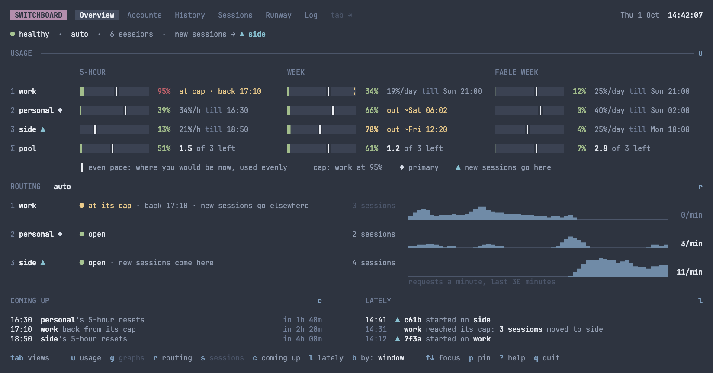
</div>

The dashboard is drawn in a theme. A theme names its colours by what they mean and how prominent
they are, never by hue.

### Built-in themes

| Theme | What it is |
|---|---|
| `nord` | The dashboard's palette from the start. |
| `tokyo-night` | Tokyo Night. |
| `tokyo-night-day` | Tokyo Night, for a light terminal. |
| `amber` | An amber CRT. |
| `exchange` | A telephone exchange's brass and walnut. |
| `terminal` | For a terminal with a transparent or image background. It paints no background, and draws in the terminal's own sixteen colours. |

### One theme, or a pair

You can choose one theme for every terminal, or a pair: one for a light background and one for a
dark one.

- As it starts, the dashboard asks the terminal what its background is. It takes a terminal that
  doesn't say for a dark one.
- If you choose nothing, you get the pair of `tokyo-night-day` and `nord`.

### The picker

`t` opens the theme picker, a panel at the right, over the dashboard. It lists every theme.

- `↑` and `↓` move through the themes. The dashboard is redrawn in each theme as you reach it.
- `enter` sets the one theme.
- `d` and `l` set the dark and the light half of the pair. If a single theme is set, they ask first,
  with `y` or `n`, whether to clear it.
- `esc` closes the picker, putting back the theme in force.

While the picker is open, a trace it would cover, in ROUTING or SESSIONS, drops its oldest minutes
instead, so it keeps now and its rate in view. On a narrow screen, where the picker covers the whole
trace, the trace stays under it.

A badge says what each theme fills:

| Badge | Means |
|---|---|
| `●` | the one theme |
| `● light` | the light half of the pair |
| `● dark` | the dark half of the pair |
| `● both` | both halves of the pair |

A theme file that doesn't load is listed with why, such as `bad colour` or `missing tokens`. The
log has the detail.

### Your own themes

A theme is a file named `<slug>.theme`. The slug is lower-case letters, digits and hyphens.

- Put it in the themes directory, at its top level. See
  [Where things live](reference.md#where-things-live).
- Links are followed.
- The picker reads the directory again each time it opens.
- A file can't take a built-in theme's slug.

Each line is `key = #RRGGBB`. A line starting `#` is a comment. Each key appears once.

```
# Lake: a dark theme.
text.primary = #ECEFF4
canvas = #102030
...
```

A theme gives all 19 base tokens, or it doesn't load:

- `text.primary`, `text.secondary`, `text.tertiary`, `text.muted`, `text.subtle`, `text.faint`,
  `text.on-selection` and `text.on-attention`
- `accent.primary`, `accent.key`, `accent.mode` and `accent.attention`
- `state.positive` and `state.destructive`
- `canvas`, `bg.selection`, `bg.attention` and `bg.subtle`
- `border`.

The charts have tokens of their own. Where a file leaves one out, the dashboard works it out from
the base tokens.

| Token | Colours |
|---|---|
| `viz.ramp.1` to `viz.ramp.4` | a bar's fill, first cell to last |
| `viz.track` | a bar's track |
| `viz.pace` | the even-pace mark |
| `viz.reserve` | the cap's mark |
| `viz.family.1` to `viz.family.4` | the model families: Opus, Sonnet, Fable and Haiku |
| `viz.version.1` to `viz.version.6` | the model versions: a family's newest in its family's colour, and an older one fainter |
| `viz.day.0` to `viz.day.4` | History's shades of a day, from one with nothing on it to the busiest |

A key switchboard doesn't know is passed over.

### Where the choice is kept

The dashboard keeps your choice in `prefs.json` in the state directory. The dashboard writes this
file, and you never need to. If the file can't be read, it's set aside as
`prefs.json.corrupt-<unix time>`, and the defaults stand.

### The background

The dashboard paints the theme's background on every cell. It also sets the terminal's own
background to it, and puts it back as it was when the dashboard stops. That's on `q`, an interrupt
or a terminate signal, or a crash it catches. A terminal that didn't say what its background was is
reset to its profile's own background instead.

[`usage`](commands.md#usage) paints no background, as it prints into the scrollback:

- It asks the terminal what its background is, and takes the light or dark half of the pair to
  match.
- If you chose one theme, it prints in that theme only on a background as dark or as light as the
  theme's own. Otherwise it uses the default pair's half for that background.

### Fewer colours, and none

The colours are brought down to what the terminal shows.

With `NO_COLOR` set to anything:

- The dashboard has no colour, and no background. Its glyphs and bold say what colour would.
- `t` does nothing.

`usage` has no colour either, with `NO_COLOR` set or on a terminal that shows no colour. Its bars
are then filled in `█`. Printed off a terminal, as `usage --pretty` prints it, it has no colour
unless `CLICOLOR_FORCE` asks for it.
