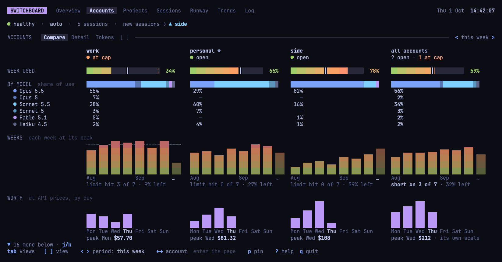

# Accounts: each account in depth, over any period

Accounts sets your accounts side by side over a period you choose, from today to 12 months. Look
at it to see which account hits its limit most, and how full each week got. It also sets what the
use was worth against each plan. It has three views on sub-tabs: Compare, Detail and Tokens.

*Compare over this week: a column for each account, and one for all accounts.*

Press `[` and `]` to move between the views. With one account, Compare goes, and the keys move
between Detail and Tokens.

## The period: one dial for the dashboard

The dial at the right of the heading sets the period, for example `< this week >`. Step it back to
see last week whole, or what a day in September was worth. Every view on Accounts counts over the
period, and so do [Projects](projects.md) and the List on [Sessions](sessions.md).

| Key | Does |
|---|---|
| `<` | Steps back to the period of the same length before this one: today to yesterday, this week to last week. |
| `>` | Steps on again. It stops at now. |
| `-` `+` | Changes the length, from today to 12 months. `=` counts as `+`. |
| `n` | Goes back to now. |

Changing the length keeps the last day of the period. For example, `+` on last week gives the 30
days to the last day of that week. The key line reads `- + period: this week    < > back · on`, and
adds `n now` while a past period shows. A key that can't act is drawn faint: `>` at now, and `<`
at the first day switchboard recorded.

| Length | Now runs over | A past period reads |
|---|---|---|
| today | today, from midnight | `yesterday`, then `Tue 29 Sep` |
| this week | this week, from its start | `last week`, then `week of 14 Sep` |
| 30 days | the last 30 days, back from today | `30 days to 1 Sep` |
| 12 weeks | this week and the 11 before it | `12 weeks to 12 Jul` |
| 12 months | the last 12 months, back from today: the same days as YEAR on [Trends](trends.md) | `12 months to 1 Oct 2025` |

A period is never a billing month, because switchboard doesn't know when a plan renews. The
dashboard always opens on now, and remembers only the length from one run to the next.

## Past periods: what leaves

A past period names itself in a colour of its own in the heading, so it never reads as now. It
stays put as midnight passes. What tells the moment leaves, because it says nothing of the past:

| View | In a past period |
|---|---|
| Compare | The state rows, the token rows and WEEK USED leave. |
| Detail | The state, the token line, the state marks in the list, USAGE and SESSIONS leave. LATELY tells the events of the account up to the end of the period. |
| Tokens | Nothing leaves. The first row names the period, for example `30 days to 1 Sep`. |

The rest counts over the days of the past period, by the same rules as now.

## Compare: every account side by side

Compare has a column for each account, in the order of your config, and a last one for
`all accounts`. Each column has these groups:

| Group | Shows |
|---|---|
| WEEK USED | The week window as it stands now, as a bar, at any length. A past period has none. |
| BY MODEL | The share of use by model version over the period. |
| WEEKS | How full each week got, as columns. |
| WORTH | What the use was worth at API prices over the period. |
| ACTIVITY | The requests, and the sessions served and moved. |
| LIMITS | The limits hit, the time spent at the cap or a limit, and what was left at the last reset. |
| VALUE | The plan, extra usage, and what the plan costs against the worth. |

**WEEKS** shows at least the last eight weeks, or every week of the period if there are more. At 12
months, a column is a month at its fullest week.

- A dotted line marks the cap, on an account that keeps a reserve.
- `…` marks this week, so far, except at 12 months.
- Under the columns, a line counts the limits hit and the average room left at a reset:
  `limit hit 3 of 7 · 9% left at a reset`.
- The `all accounts` column counts the weeks some account was short: `short on 3 of 7`.

**WORTH** is drawn by hour, two hours, day, week or month, the finest that fits. The peak is named
under it, as in `peak Wed $148`. Today is by the hour the requests arrived in. The accounts share
one scale, so their columns compare. The `all accounts` column has a scale of its own, and says so.

**VALUE** in the `all accounts` column counts only the plans it knows. If an account has no `plan`
set, the column says how many plans it knows, because its worth counts every account.

If a token expires within 30 days, or has expired, the column says so under the state:
`token: 21 days left`.

Press `←` and `→` to move a focus along the columns, and `enter` to open the focused account in
Detail.

## Detail: one account, the whole screen

Detail shows one account, or all of them, chosen from a list on the left. It fills the screen with:

- **USAGE:** the windows now.
- **The period:** requests, limits, plan, worth and extra usage.
- **BY MODEL:** the use by model.
- **The weeks:** as many as fit across the screen, never fewer than the period holds if they fit,
  and at least six. The rule above them names them: `the last nine weeks`.
- **WORTH:** what the use was worth at API prices over the period, with the peak.
- **SESSIONS:** the sessions on the account now.
- **LATELY:** every event the router reports, down to the key line. The rest scrolls, as
  `▼ 12 more below` says.

At 12 months, the weeks are the latest that fit, with a count of the rest on the left: `‹ 38 more`.

**For one account,** the weeks show a day and a week at a time. Under them, a line gives the facts
on the whole weeks: `limit hit 3 of the last 7 weeks · 9% left at a reset, on average`. For a
verdict on how many accounts you need, run [`switchboard history`](../commands/history.md).

**For all accounts,** the weeks are a band of week columns for each account, `all accounts` first.
The peak of each week sits under its column, and the facts sit on the right. If Detail is stacked,
or too narrow for a week of bands, the weeks become a table instead. The table has a row an
account, with the facts in two columns.

If a token expires within 30 days, or has expired, a line under the state says so. It names the
command that makes a new one: `token expires 17 Nov 2026 · 21 days left — switchboard setup makes a
new one`.

### Moving around Detail

Press `↑` and `↓` to choose an account, then `→` to move into its sessions and `←` to go back.
`enter` opens the chosen session on [the session page](session-page.md). In the list, `enter` opens
the session last chosen there, or else the first one running on the account. The key line says
`enter its page`.

- The chosen row is lit only where `↑` and `↓` act, in the list or in the sessions.
- The chosen row of the other is bold, marked `▸`.
- `SESSIONS` is bright while you're in them.
- The screen scrolls to keep the sessions, and the chosen one, in view.

The list widens to fit the account names if the screen has room, as the name column in USAGE does.

## Tokens: the ccusage report

Tokens is the report ccusage gives, inside switchboard, over the period. It shows the tokens by
kind, and their worth at API prices against what the plans cost.

- **The first row** is the whole period, named for it, as in `this week`. It sums the rows under
  it, and sets the worth against what the plans cost over the period: `4.6× its $138 week`. A rule
  sets it off.
- **Then a row a day** over this week and 30 days, a week over 12 weeks, or a month over 12
  months, newest first. Today has only the period row.
- **Each row** sets the worth against what the plans cost over it: `5.6× its $20 day`.
- **A row that begins part-way through** is priced by its days from then. The oldest month at 12
  months is one, and so is the month the ledger began.
- **An account you've removed** keeps its rows while the period holds its days, under the label it
  had, in faint text. That tells it apart from an account you've given the same label since.

Press `v` to split each row by account, by model, by both, or not at all.

## Room by width

**Compare** scrolls its rows under the account names if they don't all fit. If the columns don't
fit, `←` and `→` scroll them. If two accounts and `all accounts` don't fit side by side, as on a
phone, Compare turns:

- It shows a group at a time, an account a row, with no focus.
- WEEKS becomes a band for each account: the week columns, each peak under its column, and the
  facts on the right.
- WORTH becomes a chart across the screen for each account, with its peak under it.

**Tokens** fills the screen down to the footnote. On a narrower screen, its columns give way one at
a time, in this order:

1. the model count;
2. cache write;
3. input;
4. output;
5. the worth against the price;
6. cache read.

Total and worth always show. The names stay whole until every other column has gone.

## Keys on Accounts

| Key | Does |
|---|---|
| `[` `]` | Moves between Compare, Detail and Tokens. |
| `<` `>` | Steps the period back and on in time. `>` stops at now. |
| `-` `+` | Changes the length of the period. `=` counts as `+`. |
| `n` | Goes back to now. |
| `←` `→` | On Compare, moves the focus along the columns. |
| `enter` | On Compare, opens the focused account in Detail. |
| `esc` | On Compare, ends the focus. |
| `↑` `↓` | In Detail, chooses the account, `all accounts` first. |
| `→` `←` | In Detail, `→` moves into the sessions of the chosen account, and `←` goes back to the list. |
| `↑` `↓`, then `enter` | In the sessions on Detail, chooses a session, and opens its page. |
| `enter` | In the list on Detail, opens the page of the session last chosen, or else of the first one running. |
| `v` | On Tokens, splits each row by account, by model, by both, or not at all. |
| `j` `k` | Scroll Compare, Detail or Tokens, a row at a time. |

The keys every page shares are on [Every page](every-page.md).
