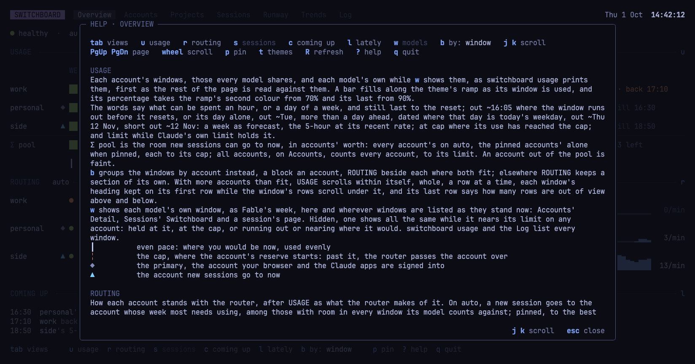

# Every page: learn the keys once, use them on every tab

Every page of the dashboard sits in the same frame, with the same status line, help and keys. Learn
them once and they work on every tab. This page covers what the frame holds, the keys that work
everywhere, and what a click does.

*Help on the Overview, opened with `?`.*

## The frame: top to bottom

Every page is one frame. From top to bottom, it has:

1. **The title row:** the tabs and the clock. Once there's a second pool, the label of the pool
   shown follows the badge, on a colour of that pool's own. On a phone, a blank row sits above the
   tabs.
2. **The status line:** how the router stands.
3. **The heading row:** the name of the tab and a rule. The Overview and Trends have none, because
   they head their own sections.
4. **The view.**
5. **The key line:** the keys that work on the page.

### Loading

If a tab reads a lot, the heading row says `loading…` until the read lands, for example on Sessions
or the Log with a long ledger. A quick read says nothing.

| On | `loading…` shows in |
|---|---|
| A tab with a heading row | the heading row |
| The Overview | the SESSIONS heading |
| Trends | the first section's heading |

The Log, the List on Sessions and the session page keep reading what the ledger gains while another
tab shows. So each one is up to date when you come back to it. The Log keeps only the days it
shows. Once today fills it, it lets go of yesterday, and scrolling back reads yesterday in again.

## The tabs

Press `tab` and `shift-tab` to move between the seven tabs, in the title row's order:

1. Overview
2. Accounts
3. Projects
4. Sessions
5. Runway
6. Trends
7. Log

The order goes round, from the Log back to the Overview. The next dashboard you open starts on the
tab you showed last.

## The status line

The status line says how the router stands, whatever a tab shows. It starts with one of these:

| Status | Means |
|---|---|
| `● healthy` | The router is answering. |
| `■ the router isn't answering  ·  since 14:40:55` | The last view of the router stays on screen. |
| `○ probed · router not running` | The dashboard reads the accounts itself. |
| `○ probed · router started before pools` | The config has pools, but the router started before them and doesn't route by them. Restart it. |

Then the line says:

- how the router routes: `auto` or `pinned to personal`;
- the sessions the router has routed in the last hour;
- where new sessions go: `new sessions → ▲ side`.

A pool with no accounts says only `no accounts`.

## Help

Press `?` to open help over the page. The help card shows:

- every key that works on the page;
- what each part of the page shows, and how to read it;
- what the marks on the page mean.

`j` and `k` scroll the card a row, and `PgDn` and `PgUp` a page. `?` or `esc` closes it.

## Keys on every page

These keys work on every page. The keys of each tab are on its own page: [Overview](overview.md),
[Accounts](accounts.md), [Projects](projects.md), [Sessions](sessions.md), [Runway](runway.md),
[Trends](trends.md), [the Log](log.md) and [the session page](session-page.md).

| Key | Does |
|---|---|
| `tab` | Moves to the next tab. From the session page, moves to the tab after the one the page was opened from. |
| `shift-tab` | Moves to the tab before. From the session page, moves to the tab before the one the page was opened from. |
| `[` `]` | On Accounts, Sessions and the Log, moves to the sub-tab before or after, round. |
| `p` | Opens the routing card. See [The routing card](routing-card.md). |
| `P` | Turns to the next pool, reading the pools afresh. With one pool, says so. See [Running it](running-it.md). |
| `R` | Refreshes now. |
| `t` | Opens the theme picker. See [Themes](themes.md). |
| `?` | Opens help for the page. |
| `esc` | Closes what's open, newest first. |
| `q` | Quits, except while a card, or the Log's panel or find, is open. Then only their keys act. |
| `ctrl-c` | Quits, wherever you are. |

### Refreshing with `R`

`R` has the router probe:

- the accounts it hasn't read in the last minute;
- the accounts that can take no request, however lately it read them.

The router doesn't probe an account whose 5-hour window has lapsed and that can take a request. It
probes no account twice in a minute. Without the router, `R` probes every account.

### Closing and going back

`esc` closes what's open, the newest first:

- a card;
- the theme picker;
- the Log's `f` panel;
- the Log's find;
- a turn opened on the session page.

With nothing open, `esc` ends a choice. On the Log, it follows again while the table is paused,
as `end` does, and otherwise clears a filter. On the session page, it goes back to where you
opened the page.

## Scrolling

If a view doesn't fit, these keys scroll it:

| Key | Scrolls |
|---|---|
| `j` `k` | a row |
| `PgDn` `PgUp` | a page |
| the wheel | three rows a turn |

What scrolls on each page:

| Page | Scrolls |
|---|---|
| Overview | USAGE, if its accounts don't fit. `↑` and `↓` scroll it too. |
| Accounts | the view |
| Projects | the SESSIONS of a project. The list follows the project chosen with `↑` and `↓`. Over the list, the wheel chooses the next project as your fingers move down. |
| Sessions | the List, and the accounts on the Switchboard if they don't fit |
| Runway | the lanes |
| Trends | the whole page, if its sections don't fit. `?` always lists its scrolling keys. |
| The Log | the table |
| The session page | the turns, or with a turn open, its requests |

USAGE scrolls whole, a row at a time. The heading of each window stays on its first row while the
rows of that window pass under it. The last row says how many rows are out of view above and below.

### An account at a time

The Switchboard on Sessions and the lanes on Runway scroll an account at a time. A turn of the
wheel does the same. If one account doesn't fit, as on a short screen, the view scrolls whole, a
row at a time. It then says how many rows are out of view above and below.

### Paging passes over nothing

Paging is exact, so you never miss a row:

- A page down starts at the first row the page didn't show.
- A page up ends just above the first row it showed.

When the Switchboard scrolls an account at a time, the same holds for accounts.

### Back to the top

A view goes back to its top when a resize, or what's read, turns it from one kind of scrolling to
the other. USAGE also goes back to its top when:

- `b` groups it the other way;
- a resize changes how it's laid out;
- a read changes its rows over the key line, for example when a model window appears.

## The key line

The key line, the last row, lists the keys that work on the page, in this order:

1. `tab views`, or on the session page, `esc back`.
2. The page's own keys.
3. `p pin`, if a pin can be set, and `P pool`, if there's more than one pool.
4. `? help  q quit`.

A key that can't act now is drawn faint. If you press it, the key line says why, in place of the
keys, for 4 seconds. `t`, `R` and the scrolling keys work everywhere, and are left to `?`.

The Overview lists its section toggles, each word faint while its section is hidden. Then come
`b by: window` and `p pin  ? help  q quit`.

Trends lists its toggles the same way:
`w week  o pool  g glance  h when  y year  m months  d models`. While YEAR or BY MONTH shows, `v split: all` follows. Then come `p pin  ? help  q quit`.
If the line doesn't fit whole, `v split` goes first.

On a phone, or wherever the line doesn't fit whole:

- `? keys` and `q quit` end it. On the Overview and Trends, it's `? keys and toggles`.
- `tab views` leads it, while it fits.
- `P pool` stays, if there's more than one pool. `p pin` is left to `?`.

## Clicks

The mouse is on while the dashboard runs. To select text, hold your terminal's modifier key:
Option in iTerm2 and Terminal.app, and Shift in most others.

| Click on | Does |
|---|---|
| a tab or a sub-tab | Shows it. |
| the pool label in the title row | Turns to the next pool, as `P` does. After the last pool, turns back to the first. |
| `<` or `>` by a period | Steps it. |
| a key on the key line | Does what the key does. For a pair, such as `[ ]` or `< >`, does what the second key does. Doesn't act on `p pin` or `q quit`. |
| a row that names an account, a project, a session, a line or a turn, or the head of a Compare column | Chooses it, as the arrows would. On the one already chosen, opens it, as `enter` does. |
| a section heading, on the Overview or Trends | Hides the section. |
| `▼ 214 new`, on the Log | Follows again. |
| a tick in the `f` panel on the Log | Ticks it. |

The wheel scrolls what's under the pointer. Some rows act differently:

- A click on a row of SESSIONS on the Overview opens the session page at once.
- A click on an account in the list on Detail, or a project in the list on Projects, opens nothing.
- With a turn open, a click on a turn closes the open turn. If the turn clicked is another, the
  click then chooses it.

Over the list on Projects, the wheel chooses a project instead of scrolling. The wheel chooses the
next project as your fingers move down, whichever way your Mac scrolls.

No click opens the routing card or acts in it, so a stray click never moves a session.
