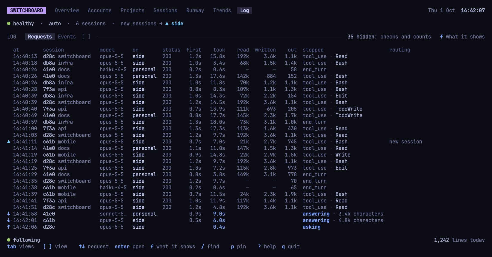

# The Log

**The Log** shows the router's traffic, as it happens and back through the days. It has two
tables under one tab, Requests and Events, and `[` and `]` move between them. The newest line is at
the foot.

## Requests

Requests has a line for each request the router routes. Each line shows:

- when the request was made
- its session, model and account
- its status
- how long it took
- its tokens by kind
- why its answer stopped
- how the router chose its account, with a move's cost.

`f` can show more columns:

- worth at API prices
- input tokens
- attempts
- size, messages, tools and thinking budget
- the client that sent the request
- the router's id for the request.

`f` can also show Claude Code's quota checks and counts of tokens. These stay hidden until you
choose them, as neither is work done for you.

## Events

Events has a line for each thing the router decides or notices. Every move the router makes is
there, with why.

## Keys on the Log

| Key | Does |
|---|---|
| `↑` `↓` | Chooses a line. `↑` while following chooses the newest line and pauses the table. With a line's details open, moves to the line before or after. |
| `end` | Follows again: the newest line at the foot, and nothing chosen. |
| `enter` | Opens the chosen line's details. |
| `s` | Opens the page of the chosen line's session. Does nothing on an account's event. |
| `g` | On the details of an event, shows the Requests, paused at the event's moment. |
| `f` | Opens a panel that sets what the Log shows: its columns, and which lines. |
| `/` | Finds a session by the start of its id or its directory's name. |
| `esc` | With a filter on and nothing open, clears the filter. |

In the `f` panel:

- `←` and `→` move between its sides.
- `↑` and `↓` move through a side's ticks.
- `space` ticks the one the cursor is on.
- `enter` applies the ticks, and `esc` closes the panel unchanged.
- `/` closes the panel for the find.

The find looks at today's sessions first, then back a day at a time. You type in it as in setup's
fields: `←`, `→`, `home` and `end` move the cursor, `backspace` and `delete` take out a character,
and a paste goes in at the cursor. `↑`, `↓` and `enter` pick a session, filtering both tables to it.
