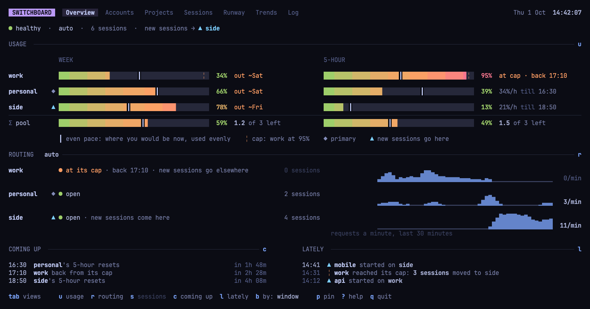

# Overview

The **Overview** shows every account's windows and how the router stands with each. It fits on
one screen that never scrolls.

## Sections

The Overview has five sections, always in this order. Each key shows or hides its section, at any
size.

| Section | Key | At first |
|---|---|---|
| USAGE | `u` | shown |
| ROUTING | `r` | shown |
| SESSIONS | `s` | hidden |
| COMING UP | `c` | shown |
| LATELY | `l` | shown |

The terminal's size never decides which sections show. It decides only how much room each section
gets:

- When rows run short, sections fold to their headings. Each folded heading still says what the
  section holds.
- Before a section folds, USAGE's accounts close up, the blank row between each two giving way.
  They close up only where that keeps a section open.
- Sections fold in this order: SESSIONS first, then COMING UP and LATELY, then ROUTING.
- USAGE never folds. Short of its rows, with every other section folded, it shows as many
  accounts as it can: its accounts close up, then the blank rows under its headings give way,
  then its key, as far as shows the most, and where they still don't fit, it scrolls within
  itself.
- A folded section opens again wherever it fits, the last folded first.
- Spare rows grow the sections that aren't folded, up to their full size, even while others are
  folded. SESSIONS takes them first, a whole session at a time.

## USAGE

USAGE is the block that [`usage`](../commands/usage.md) prints: every account's windows, and the
pool's.

- Wherever its windows fit side by side, it's the matrix: from 86 columns with two windows and
  short names, its bars at least 12 cells. Given the room, it stacks the windows at the full width
  instead, their bars as long.
- Narrower, as on a phone, it stacks the windows as `usage` stacks them.
- Its name column is as wide as the longest name, up to 24 cells of label, wherever the screen has
  room. A bar only grows as the screen widens: the words go from short to full first.
- Each name's marks, `◆` and `▲`, stand at the end of the name column, a cell before what
  follows, so they line up down the list, and under them ROUTING's and SESSIONS'. Every list of
  accounts in a column does the same, Compare's rows on a phone among them.
- An account out of the pool, under a pin, is drawn faint.
- An account without a 5-hour window reads `no 5-hour limit` in place of its bar, or `no limit`
  where the room is short, and by account, where the window's label beside it names the window. In a
  stacked 5-HOUR section, it's left out. A window no account has isn't shown, and with only the week
  left, USAGE stacks it at the full width wherever it fits. Accounts' Detail and Sessions' lines say
  `no limit` beside the window's name, and a session's page and the routing card `no 5-hour limit`.
- The pool's room counts only the accounts that have the window, such as `1.2 of 3 left`. Where
  fewer than two of them have it, and not all, the pool shows nothing for it.

Each model's own window, such as Fable's week, is hidden until you press `w`. That goes for every
view that shows the windows as they stand now: USAGE, Accounts' Detail, Sessions' Switchboard and
a session's page. A hidden window still shows while it nears its limit on any
account: at the limit, at the cap, running out, or within 10 points of running out. `usage`
and the Log always show every window.

The key line under the block names the marks:

| Mark | Means |
|---|---|
| `┃` | even pace |
| `╎` | the cap |
| `◆` | the primary |
| `▲` | where new sessions go |

Where the key line has no room for `▲ new sessions go here`, it says `▲ new`. With one account,
which has no pool, USAGE's heading says the room it has left in each window, wherever the heading
has room for it.

## ROUTING

ROUTING says, in words, how each account stands with the router. For example:

- `● under pressure · out ~16:05`
- `■ limit reached · back 15:54`
- `○ idle · window starts at its prime, 16:20`
- `✕ its token is another subscription's · switchboard accounts token b6s7`, where the account's
  token file holds another subscription's token, which USAGE and Runway call `wrong token` (see
  [A token that's another subscription's](../commands/accounts.md))
- `● pinned`, on each account the pin names, where it has room beside the account's state, and,
  where the state says when it's back or when its pressure runs out, only where that time fits
  beside the mark too. A prime's time gives way to the mark. Where the mark doesn't fit, a
  state that says the pin says it in its words, as `● at its cap · pinned`; otherwise only the
  heading names the pinned accounts.

For each account, ROUTING also shows:

- the account's sessions
- its requests a minute over the last 30 minutes, drawn as a trace, with the last minute's rate.

The section's heading gives the routing mode: `auto`, or
`pinned to personal since 14:02   p back to auto`, or `pinned to personal` alone where the rest
doesn't fit.

Every trace on the page shares one scale, a session's trace included, so you can compare any two.

## SESSIONS

SESSIONS lists the sessions the router has routed in the last hour, busiest first. The account
whose sessions send the most requests a minute comes first, with all its sessions together, the
busiest of them first. Each session shows:

- its id, bright while the session is busy, and its project, the last part of its directory, cut
  to 12 characters as the Log cuts it, `c61b mobile`; on narrower screens the project narrows to
  6 characters, then leaves
- its model
- when it was last seen
- what it's doing, such as `↑ ask` or `↓ ~1.2k`
- why it's on its account, such as `moved from work 14:31: work reached its cap`, cut short where
  the screen hasn't room for it all (that one reads whole from 155 columns with names as short as
  the sample's, and later with longer ones), and hidden where it would have fewer than 12
  characters, under 102 columns with the sample's names
- its own trace, lined up with ROUTING's.

SESSIONS shows as many sessions as there's room for, and a row such as `+5 more` for the rest. It
folds only when there isn't room for one session and that row. The sessions it shows stay put
until the layout changes, on a key or a resize: a session that starts joins `+5 more`, one that
ends leaves its row blank, and nothing reorders as the rates change. When every row is already
taken, the last session shown gives way to the `+N more` row. Once every session it kept has
ended, it says `no sessions running`. When none were running as the layout was made, a session
that starts shows on the row where it fits whole, and otherwise is counted in `+N more`.

ROUTING takes a row for each account, and SESSIONS a row for each session, wherever an account's
name, its state in at least 20 cells, its sessions and a trace of at least 24 fit on one row, from
83 columns with a name column of 16. Narrower, each takes two.

## COMING UP and LATELY

COMING UP and LATELY sit side by side where both fit, from 95 columns, and LATELY goes under
COMING UP where they don't.

- **COMING UP** is what happens next, soonest first, such as
  `16:30  personal's 5-hour resets  in 1h 48m`. A run-out's row is in the theme's attention colour.
- **LATELY** is what the router has done, newest first. Each event is marked, such as
  `14:31  ╎ work reached its cap: 3 sessions moved to side`. When a limit, a cap or a refusal moves
  sessions, those sessions are folded into that event's line. A session is named by the folder
  it runs in, as in `api moved personal → work`, or by its short id where that isn't known.
  Where a line doesn't fit whole, it takes a shorter form, `work at its cap: 3 moved to side`. An
  account found holding another subscription's token is told as `work's token is another
  subscription's`, or `work: wrong token` where that doesn't fit.

## By account

`b` makes USAGE one block for each account, with the account's windows as rows and, from 150
columns, its ROUTING beside it. The pool's block comes last.

## Keys on the Overview

| Key | Does |
|---|---|
| `u` `r` `s` `c` `l` | Shows or hides a section: USAGE, ROUTING, SESSIONS, COMING UP and LATELY. |
| `w` | Shows or hides each model's own window, such as Fable's week. They're hidden until you press `w`. `?` lists it; the key line leaves it out. |
| `b` | Groups the windows by window or by account. Until you press `b`, the grouping follows [`[usage] by`](../configuration.md). |
| `↑` `↓` | Scroll USAGE a row, as `j` and `k` do, where its accounts don't fit. Like the other scrolling keys, it's left to `?`, which lists it only then. |
