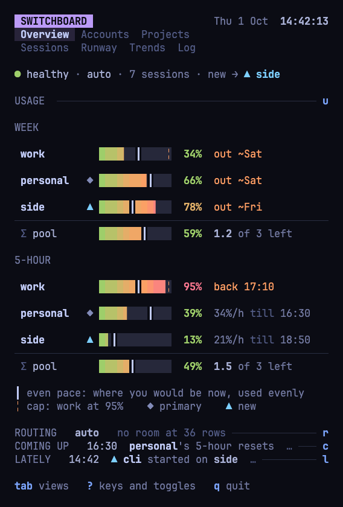

# On a phone

Every view lays itself out by what fits, at every width: each part narrows as far as it still
reads, and a view takes a narrower arrangement only where its wider one's parts don't fit. So
what a phone shows follows from its width, as it would in any narrow window. Only the page's frame
switches at one width: under 100 columns, it takes its phone form.

- The tabs sit on a row of their own, under the clock, or on as many rows as their names need
  where one can't hold them, split as evenly as their order allows; and the status line, the
  heading row and the key line say less.
- The Overview's USAGE sets its windows side by side wherever every part of a row fits at its
  least, from 86 columns with two windows and names of the sample's length, and stacks them where
  they don't. As the room runs short, its bars give way first, to 12 cells, then its words, to their
  short form, then the name column.
- ROUTING takes two rows for each account, and SESSIONS two rows for each session, as they do
  wherever one row doesn't fit, under 83 columns with a name column of 16.
- LATELY comes under COMING UP, as it does wherever the two don't fit side by side, under 95
  columns.
- Trends' cards stack, one to a row, each card's words beside its label where rows run short. See
  [Room on Trends](trends.md).
- Projects' sections stack, WORTH BY, then BY MODEL, then ON ACCOUNTS, and its list and SESSIONS
  give way column by column as they do wherever the width runs short. See [Projects](projects.md).
- Accounts' `against it` and `against` give `all accounts`' ratio alone, but where an account has
  no `plan`, they add how many of the plans it's over, compact: `4.4× · 2/3`.
- A session's page keeps each turn's number, start, length, requests, worth and accounts, as it
  does at every width: its tools, then `↑ asking`, then read, written and out, leave as the width
  runs short. An account's requests, then its time there, leave before its windows do, and the now
  rows take their short form.
