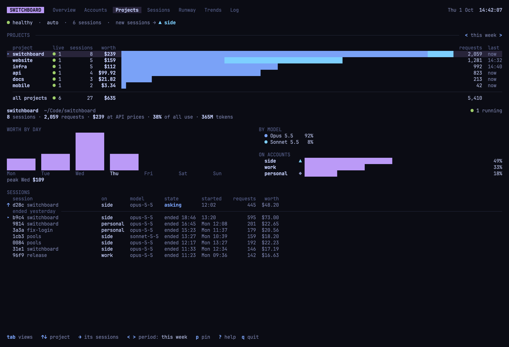

# Projects: where your use went

Projects ranks the projects your sessions ran in by what their use was worth, over the period you
choose. Look at it to see which repository took the most, on which accounts and models, and which
sessions ran there. The list is at the top, and the project you choose shows in full under it.

*Projects over this week, with switchboard chosen.*

A project is a repository, with its worktrees folded in, as the [Glossary](../glossary.md) says.
Each one is named by its folder. If two share a name, the parent folder is named too. Sessions
that didn't start through the `claude` that switchboard links share one row, `no directory`.

## The list: every project, the greatest first

The list ranks the projects by their worth at API prices. Each row has:

- the name;
- `live`, the sessions running now;
- the sessions, and their worth;
- a bar of the worth against the top project, split by model family in the family colours, as BY
  MONTH on [Trends](trends.md) splits a month;
- the requests;
- `last`, when the last request came, or `now` while a session is busy.

`all projects` totals them under a rule, counting each session once. The list takes up to a third
of the rows, and scrolls with your choice past them.

## The chosen project

Under the list, the chosen project shows:

- **The heading:** the name, the path, and the sessions running.
- **The numbers** over the period: sessions, requests, worth, the share of the worth of all
  projects, and tokens.
- **WORTH BY:** the worth in the finest bucket that fits, with the peak named under it.
- **BY MODEL:** the share of worth by model version, leaving out those under 1%.
- **ON ACCOUNTS:** the share on each account, the greatest first.
- **SESSIONS:** the sessions over the period, in the same columns as the List on
  [Sessions](sessions.md).

WORTH BY picks its bucket by the period:

| Period | Bucket |
|---|---|
| today | an hour, or two hours if a column an hour doesn't fit |
| this week | a day |
| 30 days and 12 weeks | a day, or a week if a column a day doesn't fit |
| 12 months | a week, or a month if a column a week doesn't fit |

SESSIONS lists the running sessions first. The rest follow under a rule for the day they ended:
`ended today`, `ended yesterday`, a weekday within the week, or a date before that. Each session
starts at its first request, with the day if it began on another.

Press `→` to move into the sessions, and `enter` to open one on [the session
page](session-page.md). The chosen row is lit only where `↑` and `↓` act, in the list or in the
sessions. The chosen row of the other stays bold, marked `▸`.

## Room by size

**Wide,** WORTH BY sits in the left half, with BY MODEL over ON ACCOUNTS on the right. Narrower,
WORTH BY runs across the width, with the other two side by side under it. On a phone, all three
stack.

**If rows run short,** the sections leave so that SESSIONS keeps at least three rows:

1. ON ACCOUNTS leaves first.
2. Then BY MODEL.
3. Then WORTH BY.

**If the width runs short,** the list gives way in steps:

1. The bar narrows to 8 cells.
2. The requests and `last` leave.
3. The name is cut.

## Keys on Projects

| Key | Does |
|---|---|
| `↑` `↓` | Chooses the project. |
| `→` `←` | `→` moves into the sessions of the chosen project, and `←` goes back to the list. |
| `↑` `↓`, then `enter` | In the sessions, chooses a session, and opens its page. |
| `<` `>` | Steps the period, shared with [Accounts](accounts.md) and the List on Sessions. |

The keys every page shares are on [Every page](every-page.md).
