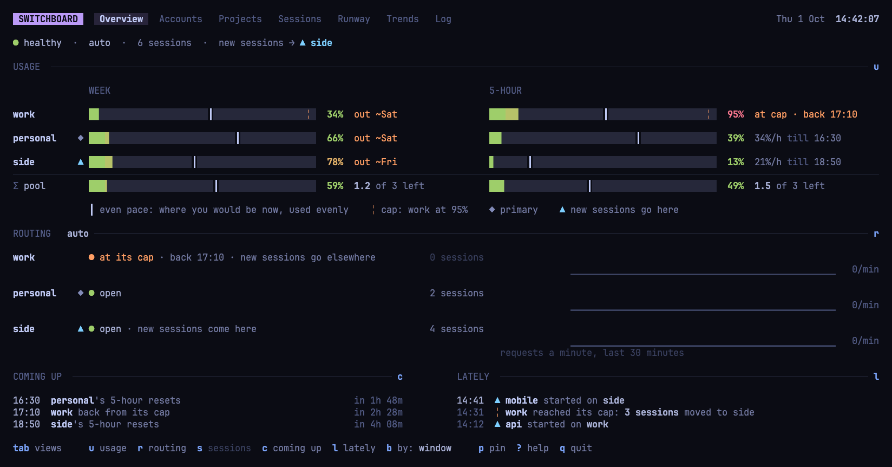

# The routing card

The **routing card** is the only way the dashboard changes routing. It changes nothing until you
press `enter`.

`p` opens the card over the page. It sets where new sessions go. Nothing is picked but what's set
now. The card has these rows:

- `auto`
- a row for each account, by its label, in the config's order.

The accounts aren't numbered, here or on any tab: each shows by its label. After you add or remove
an account, the router keeps its old list until it restarts, and every tab keeps its order till
then: an account you've removed stays while the router still holds it, and one you've added comes
after the router's last.

Each account's row shows:

- whether it's open
- its week and 5-hour window, or `no 5-hour limit` for an account without one
- why it's closed, such as `at its cap till 17:10`, or its sessions running.

## Picking

- `↑` and `↓` move between the rows, and `space` picks the row the cursor is on.
- Picking auto clears the accounts, and picking an account clears auto.
- `m` ticks moving the sessions running elsewhere to the picks too. The card then says how many
  sessions would move, and roughly what rebuilding their caches costs, such as `≈ $6.20`.
- Below, a sentence says what the picks do.

An account that can't take a session can't be picked. That's an account at a limit, one whose
token is refused, one with no token, or one whose token is another subscription's, which reads
`wrong token`.

## Applying

- `enter` applies the picks, as [`pin`](../commands/pin.md) does. The router's event names the
  dashboard as what set them.
- `esc` closes the card with nothing changed.

## When `p` does nothing

- Outside the card, `m` does nothing, so a stray key moves no session.
- While the router doesn't answer, `p pin` is drawn faint, and `p` says why instead of opening the
  card.
- With `--probe`, `p pin` isn't listed, and `p` opens nothing, even while the router answers.
- With one account, there's nothing to pin to, and `p` does nothing. The exception is a pin set
  with [`pin`](../commands/pin.md) that still stands: then `p` opens the card to clear it.

## A session's own card

On the page of a session that's running, `p` opens that session's own card. Use it to pin the
session to an account, or back to auto. It has no `m`.

## Cards over a page

A card over a page, the routing card or help, is drawn with the page faded behind it. The page
stands still while the card is open, but for the clock, which keeps ticking. The card's own
figures follow each read.
