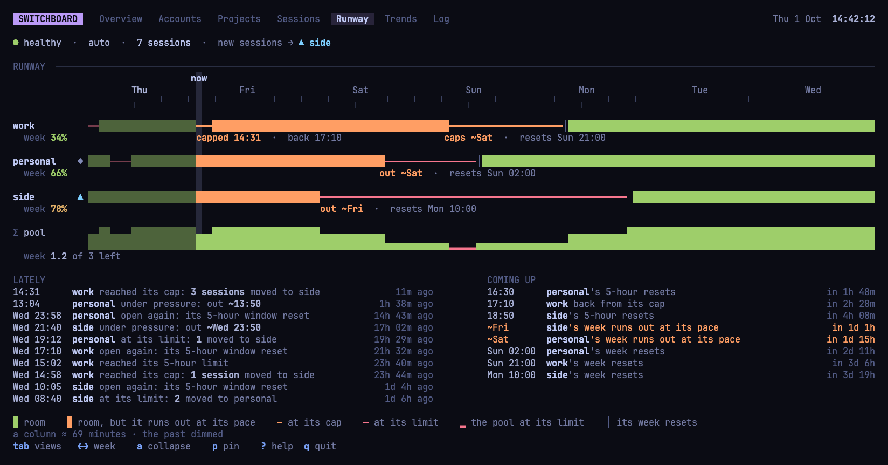

# Runway: when each account has room, over the week

Runway draws the week as a lane for each account. Each lane shows when that account has room,
reaches its cap or runs out. Look at it before a long piece of work, or to see when an account
that's out comes back.

*Runway at 160 columns: work is at its cap till 17:10, and personal and side run out before they
reset.*

## Reading a lane

The lanes cover a week, starting a day before now. Each column is one cell, and the legend at
the foot says how long a column lasts, such as `a column ≈ 69 minutes`.

| Cell | Means |
|---|---|
| `█` | The account has room. |
| `█` in the attention colour | It has room, but runs out at its pace before the reset. |
| `━` | It's at its cap. |
| `━` in red | It's at its limit. |
| `│` | Its week resets. |

- The past is dimmed.
- Under each name is how much of its week the account has used, such as `week 34%`.
- Every window that all models share counts, the 5-hour among them. A lane shows no room wherever
  any of those windows keeps the account back.

Until the router has a day of your sessions, for example on a new install, it assumes the use on
each account stays where it is. A run-out may then show earlier than it will come. If the
screen has room, Runway says so under its heading: `run-outs firm up once switchboard has a day of
your sessions`.

## Words under a lane

Words under a lane say when a stretch without room starts, and when the account is back:

| Words | Means |
|---|---|
| `capped 14:31  ·  back 17:10` | At its cap from 14:31, open again at 17:10. |
| `out 13:58  ·  back 15:30` | At its limit from 13:58, back at 15:30. |
| `out ~16:05` | Forecast to run out at 16:05. |
| `caps ~15:45` | Forecast to reach its cap at 15:45. |
| `resets Sun 01:00` | Room comes back as the window resets. |
| `lifts 19:00` | One limit or cap ends here, and another follows straight on. |

- `~` marks a time forecast at the account's pace. How the router forecasts a week is in
  [Routing rules](../reference/routing.md).
- A time more than a day ahead shows its day only, such as `out ~Sat`. If that day is today's
  weekday, the time carries the date, such as `out ~Thu 12 Nov`.
- If a cap or a run-out ends as the window resets, the words say `resets` in place of `back`.
- A limit always says `back`, whenever it lifts.
- If one limit or cap runs straight into another, only the last says when the account is back:
  `out 14:00  ·  lifts 19:00  capped 14:00  ·  back Mon 21:00`.

## The `Σ pool` lane

With more than one account, a lane for the pool sits under the others, labelled
`Σ pool`.

- Each column shows how many accounts have room.
- A low red bar along its foot, `▂`, marks where none has.
- An account with an ended subscription counts as having none from now on. So does one whose token
  Anthropic refused when the router read it.
- An account whose token Anthropic refused on a request counts as having none for the 10 minutes
  it sits out the refusal.
- Under the label is the room left in the week, such as `week 1.2 of 3 left`. It counts the
  accounts that have the week.

## COMING UP and LATELY

COMING UP and LATELY sit under the lanes:

- **COMING UP** lists what happens next, soonest first: resets, an account back from its cap, and
  run-outs. If its lines don't all fit, the last says how many more, such as `▼ 3 more`.
- **LATELY** lists what happened to each account over the past week, newest first: a cap, a limit,
  a refused token, a hold, pressure, and room again. Each line names the sessions it moved, and
  ends with how long ago, such as `11m ago`.

LATELY reads the whole week from the router's event files once, when Runway first shows. It keeps
that week as the router restarts. Until it has read the files, it shows the router's newest events.

## Collapsing the labels

The labels beside the lanes take as many columns as the widest needs, up to 24. Press `a` to
collapse them and give the lanes the width:

- The lanes start at the left edge, with no names and no marks. The status line still says where
  new sessions go.
- Under the start of each lane is its use, such as `66%`. It's faint for an account that a pin
  leaves out of the pool.
- Under the `Σ pool` lane is its room, short, such as `1.2/3`.
- The words under a lane still start under their stretch. If they would run into the use, they
  start two cells after it, as in `100%  out Tue 17:54  ·  back Sun 01:00`.
- COMING UP doesn't change, because each line names its account.

Press `a` again to expand the labels. The key line says `a collapse`, and the word is faint while
the labels are collapsed. Runway remembers which you left it on.

## Looking back a week

Press `←` to see this week, then again to step back a week at a time. Press `→` to step forward,
on to the live view. A week you step back to:

- names its dates in the heading, such as `Mon 21 Sep – Sun 27 Sep`;
- shows the week's highest use under each name;
- has no COMING UP and no LATELY.

The dashboard never keeps a step back: the next run opens on the live view.

## Keys on Runway

| Key | Does |
|---|---|
| `a` | Collapses the labels beside the lanes, or expands them again. |
| `←` `→` | `←` shows this week, then steps back a week at a time. `→` steps forward, on to the live view. |
| `j` `k` | Scroll the lanes, if they don't fit. |

## Small and wide screens

COMING UP and LATELY take the room the screen gives them:

| If the screen | Then |
|---|---|
| is 159 columns or wider, with rows for all of COMING UP in one column | LATELY sits at the left and COMING UP at the right, each down to the legend. |
| is 148 columns or wider | COMING UP takes two columns under the lanes, and LATELY runs across the screen under them. |
| is narrower | COMING UP and LATELY share one column, as wide as their lines need to read whole, from 72 columns up to the width of the screen. |
| is too short or too narrow for LATELY | COMING UP shows alone. |

LATELY shows under COMING UP only if its heading and two lines fit. It takes only the rows that
the lanes and COMING UP leave empty, so it never squeezes them.

On a short screen, for example a phone with its keyboard up, parts give way in this order:

1. LATELY, if it sits under COMING UP.
2. The lines of COMING UP that don't fit.
3. The legend.
4. COMING UP.
5. The blank row under the axis.

Only then do the lanes scroll with `j` and `k`. At the shortest, one lane shows over the `Σ pool`
lane.

Words that don't fit from where their stretch starts shift left until they do, never over the
words before. If even that can't fit them, they drop parts from the end.

If fewer than two accounts have a week, and not every account does, there's no `Σ pool` lane.

## Related

- [Trends](trends.md): a burn-down card for each account, from the same forecast.
- [Overview](overview.md): every window of every account, now.
- [Limits and routing](../limits-and-routing.md): what the router does when an account runs out.
