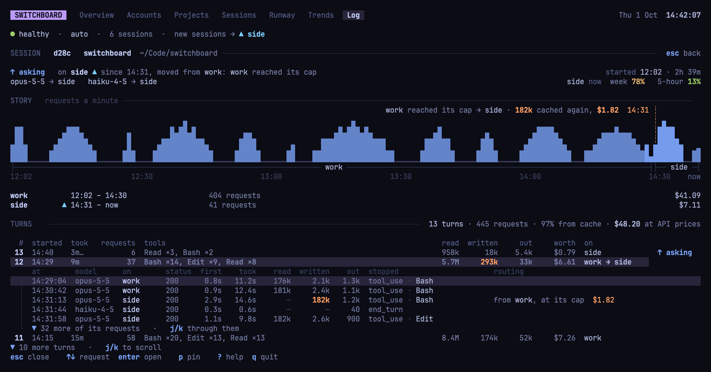

# A session's page

**A session's page** follows one session through its whole life.

The page shows:

- what the session is doing now, and where it runs
- its STORY: its requests a minute, from its first to now, with each move marked and costed
- the accounts it ran on, and what it took of each, their worth adding up to its turns', to the
  cent
- its turns, newest first.

To open a session's page, do one of these:

- Press `enter` on a session's row on Sessions, or on Accounts' Detail.
- Press `s` on a line of the Log.
- Click a row of the Overview's SESSIONS.

A session's page opens over a tab. `esc` goes back to where you opened it from, with the tab as you
left it.

A session that has run for weeks takes a moment to read. While it does, the page shows its heading
with `loading…` after it, and `esc` goes back.

A turn's requests are read from the ledger as you open it. If that takes a moment, the turn's foot
says `loading…` until they're read. An open turn's requests fill the rows there are as you open
it: those left under the turns, or where the turns fill them, those under the turn, up to five;
and down to one on a short screen. That holds as new turns arrive, until you open it again or
resize the screen. An account joining takes a row from the turns, and the turn shows one fewer
only where it had no row to spare. The request you've chosen stays in view through all of it.

On a short screen, the page keeps its rows for its turns. The STORY's bars give up a row first,
then the turns, from eight down to three, though a turn you've opened keeps its eight rows there,
then the STORY folds to its heading (on a phone it's left out), then the accounts give way to a
count, `+2 more accounts`, then the blank rows, then the turns, down to one. With a turn open, it
keeps five of the turn's requests until the blank rows have gone, then shows fewer, down to one.
Last, that count, the STORY's heading and the two rows saying what the session is doing give way,
one at a time. From 10 rows tall and 11 on a phone, it always shows a turn, and from 13 and 14 a
turn you've opened, whole.

Keys on a session's page:

| Key | Does |
|---|---|
| `↑` `↓` | Chooses a turn, or with a turn open, a request of it. |
| `enter` | Opens the chosen turn into its requests, in place. With a turn open, opens the chosen request's details. |
| `esc` | Closes the open turn, or goes back. See [Closing and going back](every-page.md). |
| `p` | While the session runs, opens the session's own routing card to pin it. See [The routing card](routing-card.md). |
| `tab` `shift-tab` | Moves to the tab after or before the one the page was opened from. |
