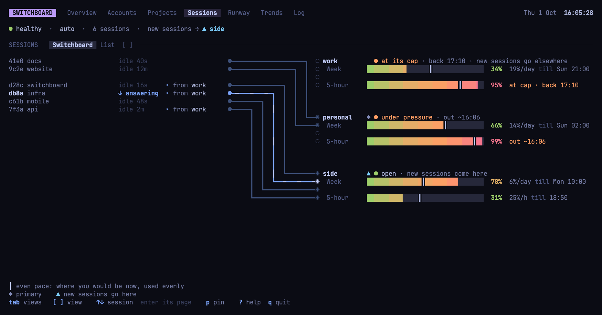

# Sessions: which account each session is on

Sessions shows where each session's requests are going now, and every session of the period.
Look at it when a limit hits, to watch sessions move to another account, or to find a session you
ran earlier. It has two views on sub-tabs, the Switchboard and the List.

<div align="center">

</div>

*The Switchboard as personal reaches its limit: its sessions are re-patched to side.*

Press `[` and `]` to move between the views. The Switchboard shows the first time. After that,
Sessions opens on the view you showed last, from one run of the dashboard to the next.

## The Switchboard: sessions corded to accounts

The Switchboard is drawn as a telephone switchboard:

- The sessions run down the left, as calls.
- The accounts run down the right, as lines, each with its windows.
- A cord runs from each call to its account.

Each session's requests travel its cord: out as they go, and back as the answer streams. A
refusal bounces back red, as `✕ 429`.

When a limit moves a session, the session joins the group of its new account. A short red cord
hangs from the old jack while the limit is in force, one for each session the limit moved. A move
made for any other reason leaves a faint cord for 3 seconds.

`Σ pool` has no line, because no session runs on it. The Overview, Runway and `usage` show it.

## The List: every session of the period

The List is a log of every session in the period. The period is the dial at the right of the
heading, the one [Accounts](accounts.md) and [Projects](projects.md) share. Over today, it's
today's sessions.

Running sessions come first. The rest follow, newest first, under a rule for the day they ended:

- `ended today`;
- `ended yesterday`;
- a weekday, such as `ended Tue`;
- beyond six days, a date, such as `ended Mon 21 Sep`.

Each row shows the session with:

- the project, then the session name, as `switchboard router-fix`;
- the account, model and state, as `ended 18:20` once it's over;
- the start time, with the day if it started on another;
- the requests in the period, and their worth at API prices;
- how it came to its account.

A row reads as it does in the sessions of a project on Projects. The line over the key line sums
the period, as `30 days  150 sessions · 33,010 requests · $3,257.86 at API prices`.

If the sessions don't all fit, the row over the key line says how many are out of view, as
`▲ 12 more sessions · ▼ 130 more sessions`. The rule for a day stays at the top while its sessions
scroll under it, so the day always shows.

## Session names: your terminal's

```
switchboard router-fix
switchboard fix-login
api         billing 2b6d
api         billing 5e7d
api         0b5c
```

Each session takes the name of the [terminal session](../glossary.md) you started it in. `claude`
reads the name once, when it starts Claude Code. If you rename the terminal session later, the
session name stays.

| If you started the session | Its session name is |
|---|---|
| Inside a zmx session | The zmx session's name |
| Inside a tmux session you named | The tmux session's name |
| With `claude --worktree <name>` | The worktree's name, if no terminal session names it |
| Outside both, in a Claude Code worktree | The worktree's name |
| Anywhere else | The first 4 characters of its id |

The project and the name are two columns, so the names line up. If two rows show the same project
and name, each adds its id, dimmed. For example, every pane of one tmux session gives its sessions
one name. The id shows as much as tells the rows apart, at least 4 characters. A session named by
its id shows its id the same way.

If your terminal uses a Nerd Font, set `nerd_font = true` under `[dashboard]` in
[the config](../configuration.md). A worktree's name then carries a tree icon. Without a Nerd
Font, the icon draws as a box, so it's off unless you turn it on.

## While the router isn't answering

Both views show the sessions the router last listed. What a session was doing then, such as
`↓ answering`, stays as it was but faint, because it may have ended since. Every other tab does the
same.

## Room by size

If the cords don't fit, as on a phone, each account carries its sessions under it in a lane. The
windows of the account depend on the height:

| If the screen is | The windows |
|---|---|
| Tall enough | Stack, a row each, as on the board. |
| Short | Sit side by side on one row. |

## Keys on Sessions

| Key | Does |
|---|---|
| `[` `]` | Move between the Switchboard and the List. |
| `↑` `↓` | Chooses a session: a call on the Switchboard, or a row on the List. If it's out of view, the view scrolls to it. |
| `enter` | Opens [the session page](session-page.md) for the chosen session, ended or running. |
| `esc` | Deselects it. |
| `<` `>` | On the List only, steps the period. |
| `j` `k` | Scroll the List a row. |

The keys every page shares are on [Every page](every-page.md).
