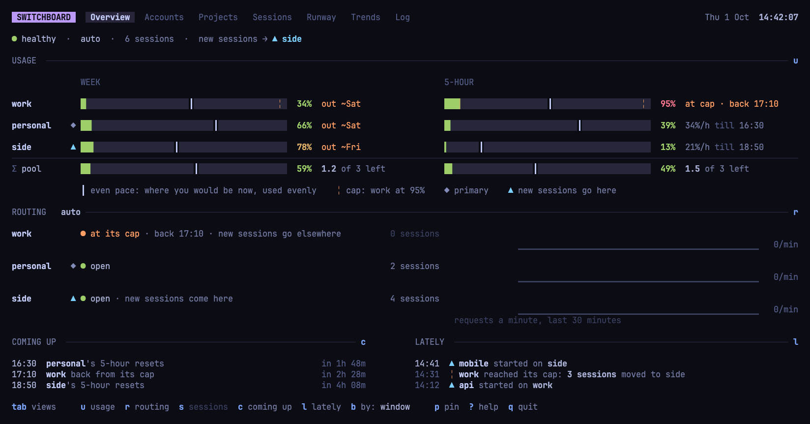
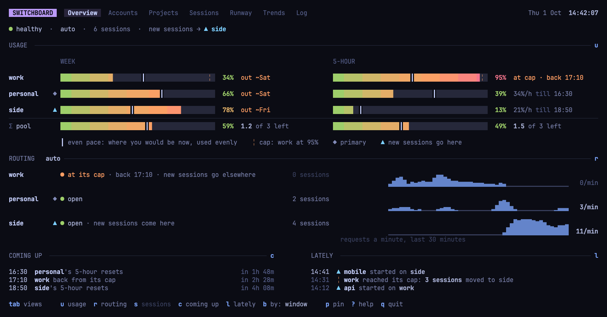
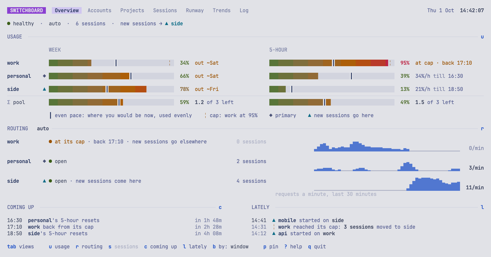
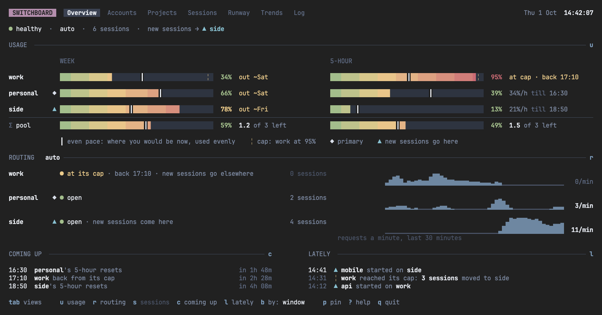
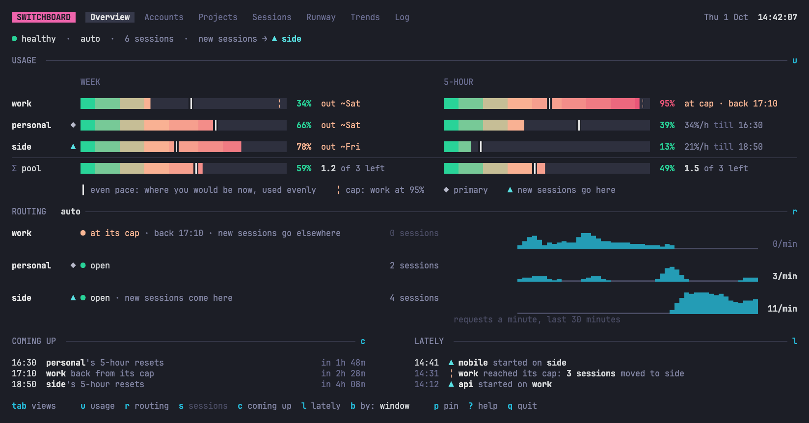
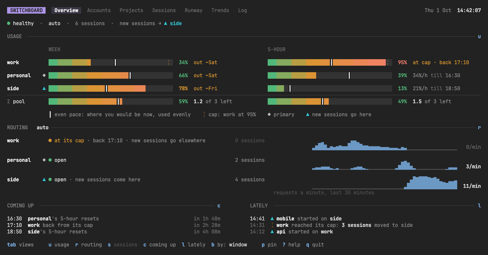
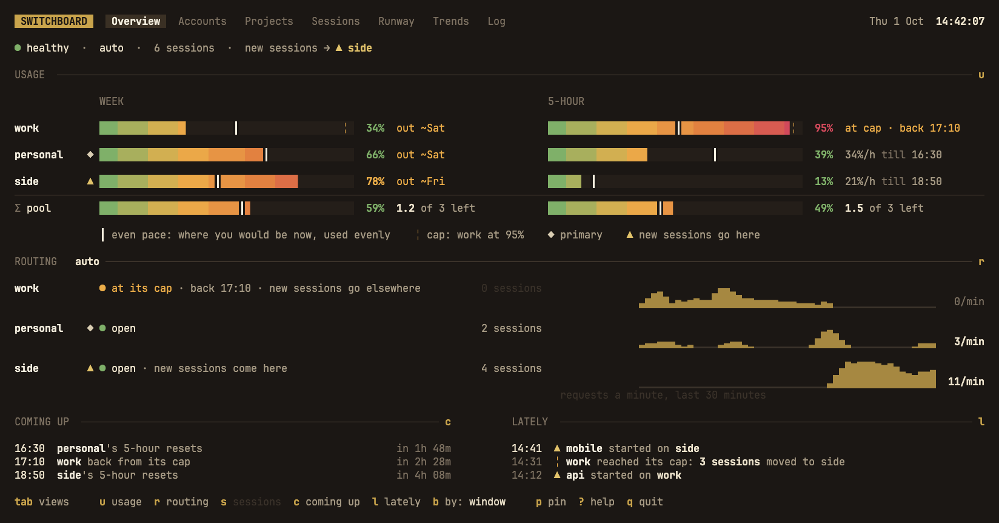

# Themes: colour the dashboard to suit your terminal

The dashboard comes with nine themes, and takes your own. Press `t` to open the picker, and the
dashboard redraws in each theme as you reach it. You can set one theme for every terminal, or a
pair: one for a light background and one for a dark one.

<div align="center">

</div>

*The picker over the Overview, the dashboard redrawn in each theme the cursor reaches.*

A theme names its colours by what they mean and how prominent they are, never by hue.

## Built-in themes

|  |  |
|:---:|:---:|
| <br>`tokyo-night`<br>Tokyo Night. | <br>`tokyo-night-day`<br>Tokyo Night, for a light terminal. |
| <br>`nord`<br>The first palette the dashboard had. | <br>`nord-wave`<br>Nord on a neutral near-black. |
| <br>`horizon`<br>Horizon: pink and peach on a cool blue-grey. | <br>`gitlab-dark-grey`<br>GitLab Dark Grey: neutral greys with a violet selection. |
| <br>`amber`<br>An amber CRT. | <br>`exchange`<br>The brass and walnut of a telephone exchange. |
| <br>`terminal`<br>For a terminal with a transparent or image background. It paints no background, and draws in the sixteen colours of the terminal: here, a Tokyo Night terminal. | |

## The picker

Press `t` to open the theme picker, a panel at the right, over the dashboard. It lists every
theme.

| Key | Does |
|---|---|
| `↑` `↓` | Move through the themes. The dashboard is redrawn in each theme as you reach it. |
| `enter` | Sets the one theme. |
| `d` `l` | Set the dark or the light half of the pair. If one theme is set, they first ask whether to clear it, and you answer `y` or `n`. |
| `esc` | Closes the picker, and puts back the theme in force. |

A badge says what each theme fills:

| Badge | Means |
|---|---|
| `●` | the one theme |
| `● light` | the light half of the pair |
| `● dark` | the dark half of the pair |
| `● both` | both halves of the pair |

- A theme file that doesn't load is listed with why, such as `bad colour` or `missing tokens`.
  The log has the detail.
- While the picker is open, a trace in ROUTING or SESSIONS that it would cover drops its oldest
  minutes instead. That keeps now and the rate in view.
- On a narrow screen, if the picker covers the whole trace, the trace stays under it.

## One theme, or a pair

If you set a pair, the dashboard picks the half to match your terminal:

- As it starts, the dashboard asks the terminal what its background is.
- If the terminal doesn't say, the dashboard takes it for a dark one.
- If you choose nothing, you get the pair of `tokyo-night-day` and `nord`.

## Your own themes

A theme is a file named `<slug>.theme`. The slug is lower-case letters, digits and hyphens.

- Put it in the themes directory, at its top level. See
  [Where things live](../reference/files.md).
- Links are followed.
- The picker reads the directory again each time it opens.
- A file can't take the slug of a built-in theme.

Each line is `key = #RRGGBB`. A line starting `#` is a comment. Each key appears once.

```
# Lake: a dark theme.
text.primary = #ECEFF4
canvas = #102030
...
```

A theme gives all 19 base tokens, or it doesn't load:

- `text.primary`, `text.secondary`, `text.tertiary`, `text.muted`, `text.subtle`, `text.faint`,
  `text.on-selection` and `text.on-attention`
- `accent.primary`, `accent.key`, `accent.mode` and `accent.attention`
- `state.positive` and `state.destructive`
- `canvas`, `bg.selection`, `bg.attention` and `bg.subtle`
- `border`.

The charts have tokens of their own. If a file leaves one out, the dashboard works it out from
the base tokens.

| Token | Colours |
|---|---|
| `viz.ramp.1` to `viz.ramp.4` | the fill of a bar, first cell to last; the first, a window that lasts to its reset, on Runway and Trends |
| `viz.track` | the track of a bar |
| `viz.pace` | the even-pace mark |
| `viz.reserve` | the mark for the cap, and the reserve on the cards on Trends |
| `viz.family.1` to `viz.family.4` | the model families: Opus, Sonnet, Fable and Haiku |
| `viz.version.1` to `viz.version.6` | the model versions: the newest in a family in the colour of that family, and an older one fainter |
| `viz.day.0` to `viz.day.4` | the shades of a day in YEAR, and of an hour in WHEN YOU WORK, from one with nothing on it to the busiest |
| `viz.account.1` to `viz.account.4` | the accounts in POOL on Trends, by place; a fifth on takes the colour four before it, fainter |

A key switchboard doesn't know is passed over.

## Where the choice is kept

The dashboard keeps your choice in `prefs.json` in the state directory, with the other choices
it remembers (see [Running it](running-it.md)). The dashboard writes this file, and you never
need to. If the file can't be read, it's set aside as
`prefs.json.corrupt-<unix time>`, and the defaults stand. The newest three set aside are kept.

## The background

The dashboard paints the theme's background on every cell. It also sets the terminal's own
background to it, and puts it back as it was when the dashboard stops. That's on `q`, an interrupt
or a terminate signal, or a crash it catches. A terminal that didn't say what its background was is
reset to the background its profile sets instead.

[`usage`](../commands/usage.md) paints no background, because it prints into the scrollback:

- It asks the terminal what its background is, and takes the light or dark half of the pair to
  match.
- If you chose one theme, it prints in that theme only on a background as dark or as light as the
  theme's own. Otherwise it uses the half of the default pair for that background.

## Fewer colours, and none

The colours are brought down to what the terminal shows.

With `NO_COLOR` set to anything:

- The dashboard has no colour, and no background. Its glyphs and bold say what colour would.
- `t` does nothing.

`usage` has no colour either, with `NO_COLOR` set or on a terminal that shows no colour. Its bars
are then filled in `█`. Printed off a terminal with `usage --pretty`, it has no colour unless
`CLICOLOR_FORCE` asks for it.

## Related

- [`switchboard usage`](../commands/usage.md): the same windows, printed once, in your theme.
- [Running it](running-it.md): what else the dashboard remembers.
