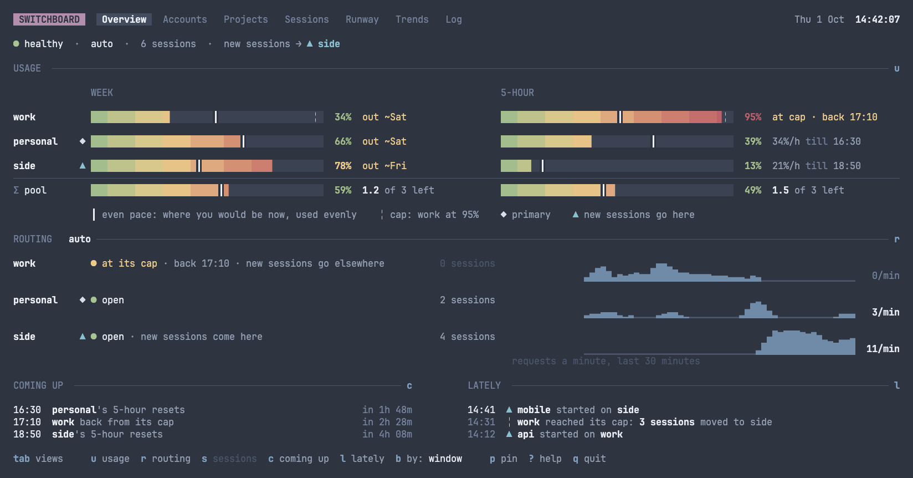
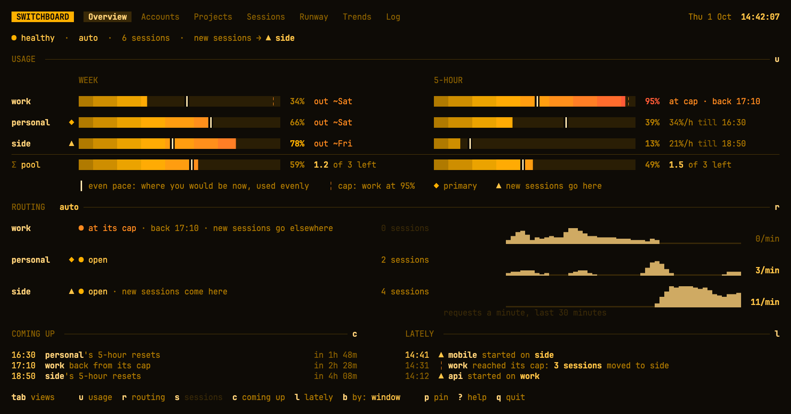
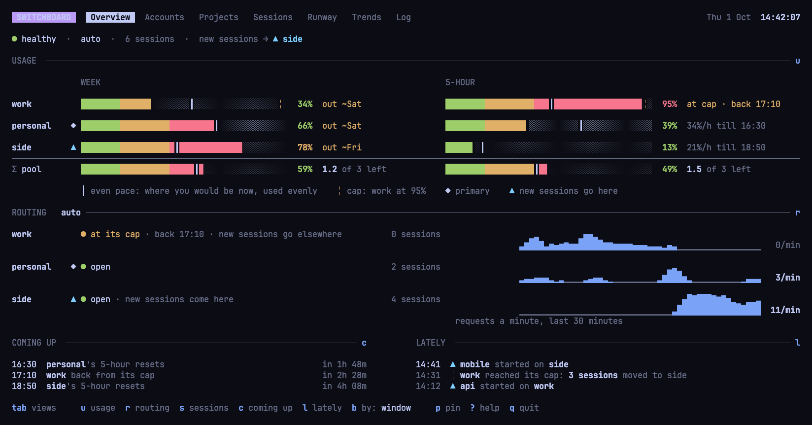

# Themes

<div align="center">

</div>

The dashboard is drawn in a theme. A theme names its colours by what they mean and how prominent
they are, never by hue.

## Built-in themes

|  |  |
|:---:|:---:|
| <br>`tokyo-night`<br>Tokyo Night. | <br>`tokyo-night-day`<br>Tokyo Night, for a light terminal. |
| <br>`nord`<br>The dashboard's palette from the start. | <br>`nord-wave`<br>Nord on a neutral near-black. |
| <br>`horizon`<br>Horizon's pink and peach on a cool blue-grey. | <br>`gitlab-dark-grey`<br>GitLab's Dark Grey: neutral greys with a violet selection. |
| <br>`amber`<br>An amber CRT. | <br>`exchange`<br>A telephone exchange's brass and walnut. |
| <br>`terminal`<br>For a terminal with a transparent or image background. It paints no background, and draws in the terminal's own sixteen colours: here, a Tokyo Night terminal's. | |

## One theme, or a pair

You can choose one theme for every terminal, or a pair: one for a light background and one for a
dark one.

- As it starts, the dashboard asks the terminal what its background is. It takes a terminal that
  doesn't say for a dark one.
- If you choose nothing, you get the pair of `tokyo-night-day` and `nord`.

## The picker

`t` opens the theme picker, a panel at the right, over the dashboard. It lists every theme.

- `↑` and `↓` move through the themes. The dashboard is redrawn in each theme as you reach it.
- `enter` sets the one theme.
- `d` and `l` set the dark and the light half of the pair. If a single theme is set, they ask first,
  with `y` or `n`, whether to clear it.
- `esc` closes the picker, putting back the theme in force.

While the picker is open, a trace it would cover, in ROUTING or SESSIONS, drops its oldest minutes
instead, so it keeps now and its rate in view. On a narrow screen, where the picker covers the whole
trace, the trace stays under it.

A badge says what each theme fills:

| Badge | Means |
|---|---|
| `●` | the one theme |
| `● light` | the light half of the pair |
| `● dark` | the dark half of the pair |
| `● both` | both halves of the pair |

A theme file that doesn't load is listed with why, such as `bad colour` or `missing tokens`. The
log has the detail.

## Your own themes

A theme is a file named `<slug>.theme`. The slug is lower-case letters, digits and hyphens.

- Put it in the themes directory, at its top level. See
  [Where things live](../reference/files.md).
- Links are followed.
- The picker reads the directory again each time it opens.
- A file can't take a built-in theme's slug.

Each line is `key = #RRGGBB`. A line starting `#` is a comment. Each key appears once.

```
# Lake: a dark theme.
text.primary = #ECEFF4
canvas = #102030
...
```

A theme gives all 19 base tokens, or it doesn't load:

- `text.primary`, `text.secondary`, `text.tertiary`, `text.muted`, `text.subtle`, `text.faint`,
  `text.on-selection` and `text.on-attention`
- `accent.primary`, `accent.key`, `accent.mode` and `accent.attention`
- `state.positive` and `state.destructive`
- `canvas`, `bg.selection`, `bg.attention` and `bg.subtle`
- `border`.

The charts have tokens of their own. Where a file leaves one out, the dashboard works it out from
the base tokens.

| Token | Colours |
|---|---|
| `viz.ramp.1` to `viz.ramp.4` | a bar's fill, first cell to last; the first, a window that lasts to its reset, on Runway and Trends |
| `viz.track` | a bar's track |
| `viz.pace` | the even-pace mark |
| `viz.reserve` | the cap's mark, and the reserve on Trends' cards |
| `viz.family.1` to `viz.family.4` | the model families: Opus, Sonnet, Fable and Haiku |
| `viz.version.1` to `viz.version.6` | the model versions: a family's newest in its family's colour, and an older one fainter |
| `viz.day.0` to `viz.day.4` | YEAR's shades of a day, and WHEN YOU WORK's of an hour, from one with nothing on it to the busiest |
| `viz.account.1` to `viz.account.4` | the pool's accounts in Trends' POOL, by place; a fifth on takes the colour four before it, fainter |

A key switchboard doesn't know is passed over.

## Where the choice is kept

The dashboard keeps your choice in `prefs.json` in the state directory. The dashboard writes this
file, and you never need to. If the file can't be read, it's set aside as
`prefs.json.corrupt-<unix time>`, and the defaults stand. The newest three set aside are kept.

## The background

The dashboard paints the theme's background on every cell. It also sets the terminal's own
background to it, and puts it back as it was when the dashboard stops. That's on `q`, an interrupt
or a terminate signal, or a crash it catches. A terminal that didn't say what its background was is
reset to its profile's own background instead.

[`usage`](../commands/usage.md) paints no background, as it prints into the scrollback:

- It asks the terminal what its background is, and takes the light or dark half of the pair to
  match.
- If you chose one theme, it prints in that theme only on a background as dark or as light as the
  theme's own. Otherwise it uses the default pair's half for that background.

## Fewer colours, and none

The colours are brought down to what the terminal shows.

With `NO_COLOR` set to anything:

- The dashboard has no colour, and no background. Its glyphs and bold say what colour would.
- `t` does nothing.

`usage` has no colour either, with `NO_COLOR` set or on a terminal that shows no colour. Its bars
are then filled in `█`. Printed off a terminal, as `usage --pretty` prints it, it has no colour
unless `CLICOLOR_FORCE` asks for it.
