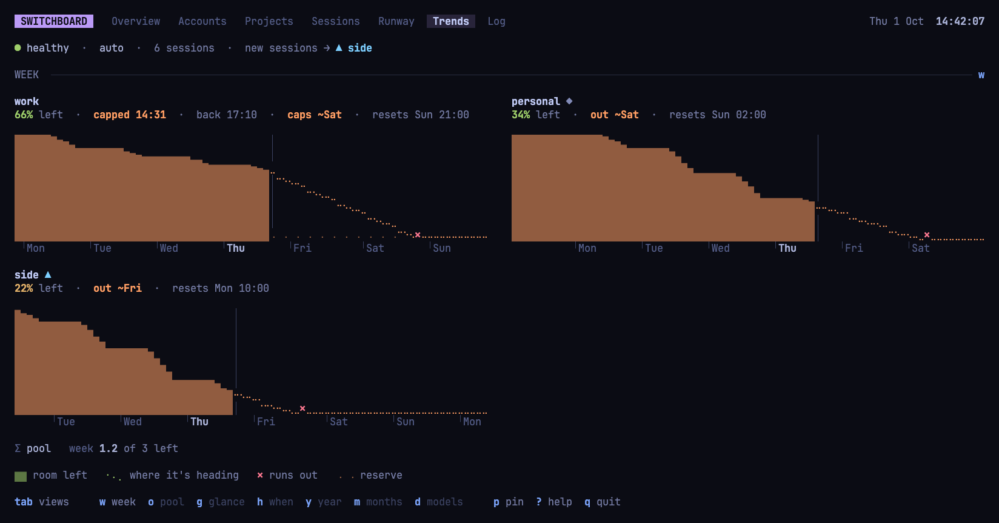
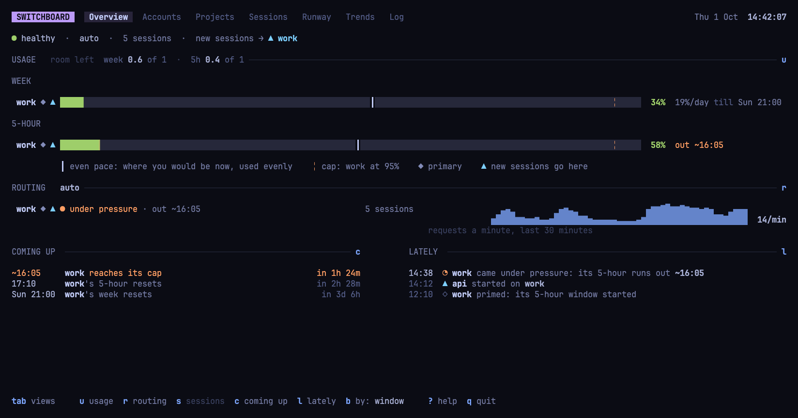

# Trends

**Trends** draws the shapes of use over time, across every account, as charts. It's a page of
sections you turn on and off: first a burn-down card for every account over its week, then
whichever other charts you show, among them the last 12 months a day at a time, each month's
worth, and each model's worth a day. Trends has no period: the cards are this week, YEAR and
BY MONTH the last 12 months, and MODELS BY DAY the last eight weeks. YEAR, BY MONTH and MODELS BY
DAY were History's, which is no longer a tab: its weeks are on Accounts' Detail, its tokens are
Accounts' Tokens, and the verdict on how many accounts you need is `switchboard history`'s.

## Sections on Trends

Trends has seven sections, always in this order. Each key shows or hides its section, at any size,
and the dashboard remembers which show.

| Section | Key | At first | What it is |
|---|---|---|---|
| WEEK | `w` | shown | A burn-down card for each account, over its week |
| POOL | `o` | hidden | The pool's room over Runway's week, each account's stacked |
| GLANCE | `g` | hidden | A row for each account and the pool: its week's room as a sparkline, with `usage`'s words |
| WHEN YOU WORK | `h` | hidden | Requests by the hour of the day and the day of the week, over the last four weeks |
| YEAR | `y` | hidden | The last 12 months a day a square, a week a column, and their totals |
| BY MONTH | `m` | hidden | A row a month: its requests, worth, worth against what the plans cost, limits, and its worth by model family |
| MODELS BY DAY | `d` | hidden | Each model family's worth a day over the last eight weeks, a strip a family |

Trends charts the week every model shares, as on Runway: a model's own week has no card, and the
5-hour window, which the Overview shows and Runway counts, has none here. With every section hidden, the
page's first row says which keys bring them back.

## The burn-down cards

Each card charts one account's room over its own week, from the week's start to its reset, a
column a cell. Each card keeps its own clock: a card's days, and its now, fall where its own week
puts them, not where the card beside it does. The cards follow the config's order, two side by side
where both fit at 35 cells or more, the rest on the rows under. Every card is as wide as the
others, so the same burn draws the same slope on each: with three accounts, the third sits under
the first, as wide. Where two don't fit side by side, as on a phone, there's a card to a row; with
one account, its card takes the width.

Over the chart, a card has the account's name and marks, and its words: the room left,
such as `66% left`, then what Runway says under the account's lane in its week view, such as
`capped 14:31  ·  back 17:10` or `out ~Sat`. The words come from
Runway's live view as Runway would draw it at the same width. So a hold shorter than one of
Runway's columns can go unsaid on a card, as on Runway, and a wider terminal, or Runway's labels
collapsed with `a`, can bring it out.

The chart:

- **The room left** is filled solid up to now, each column to the room the window had then.
- **Where it's heading** is a dotted line from now to the reset, straight to where the week is
  forecast to be, as the router would spread the pool's use (see
  [Where a week runs out](../reference/routing.md)). That's the pace Runway's words
  go by. It falls to where the week runs out, then runs along the floor it meets, its cap or
  empty, to the reset; or it ends at the room the week will have left at its reset.
- **`✕`** marks where the window runs out. Where its cap or its limit already holds it, `✕` marks
  the column the hold began in, where that's known.
- **The reserve** is a faint dotted line at the room the account's cap leaves, where the reserve
  holds. It's not drawn while a pin spends the reserve.
- **Now** is a faint `│`.

A week's colour is its state's, as Runway colours a lane: the ramp's first colour where its room
lasts to its reset, the attention colour where it runs out at its pace or its cap holds it, and red
where its limit holds it or its token is refused.

An account not read yet has Runway's words for it and an empty chart but for now. An account the
router doesn't have yet, just added to the config, has its label alone. A stale account is faded,
and one out of the pool faint.

Under the cards, `Σ pool` gives the pool's room in the week, such as `week 1.2 of 3 left`. With
one account there's no pool, and no line. At the foot, over the key line, a legend names the marks.

The animation shows one account, `work`, alone: the Overview, with its usage, its routing trace
and LATELY; then Trends, its week's card; then Runway, its lane across the week, with COMING UP
and LATELY under it.

## POOL

POOL charts the pool's room over Runway's week view, from a day before now, for a week. Each
account's room is stacked from the foot, in its own colour, so the stack's top edge is the pool's
total. Before now, each account's room as it stood; from now, drawn faint, where it's heading as
forecast: to where it runs out, along its floor to its reset, then full. Runway's axis runs
under it, and a key names each account's colour. Without colour, the accounts can't be told apart,
so POOL draws the pool's total alone.

## GLANCE

GLANCE lists every account and the pool in a few rows, as `usage` does. Each account's week is a
sparkline, its room from its start to its reset, faint from now where it's heading, with `✕` where
it runs out. Then come the room left now, such as `66%`, and `usage`'s words for the week, such as
`19%/day till Sun 21:00`. `Σ pool` gives the pool's sparkline and its room.

GLANCE takes the width: its sparklines grow with it, from 16 cells, while the room left and the
words keep the room they need, lined up down the rows. Narrower, its words take their short forms,
then its names narrow. While WHEN YOU WORK shows too, the two sit side by side wherever both fit
whole with 10 cells between, from 123 columns with the sample's names, sharing what's
spare, GLANCE taking what WHEN YOU WORK's whole hours leave; elsewhere WHEN YOU WORK comes under
GLANCE.

## WHEN YOU WORK

WHEN YOU WORK shows when your requests come: a row for each weekday, from the first day of the
week as [`week_starts`](../configuration.md) begins weeks, and the day's 24 hours across. Each hour is
shaded by its requests, averaged over the four whole weeks before today. The heading says the weeks
counted, such as `the 4 weeks to Wed 30 Sep`, or fewer, where the ledger holds fewer. With none,
the heading says no weeks, and the section says `nothing recorded yet`.

The grid takes the width: every hour's square grows with it, each as wide as the others, any
cells over left blank at the row's end, and the hours over the grid follow their columns. On a
narrow screen, an hour is a square alone, with no gap.

It counts the requests that spend quota and went upstream, each in the local hour it arrived in.
The shades are YEAR's: one for an hour with nothing on it, and four for the quarters of the
active hours, their bounds in the key under the grid.

## YEAR

YEAR is the last 12 months a day at a time: a square a day, a column a week, each day shaded by
how many requests it made, never by its worth, which shifts with the models used and their prices.
A day with nothing on it has a shade of its own, and the active days are split into quarters, the
key under the grid giving each quarter's bounds. The grid shows as many of the latest weeks as the
width holds.

Its totals, LAST 12 MONTHS, sit beside the grid where the width holds both, else under it: the
requests, sessions and limits hit; the worth at API prices, what the plans cost, and the worth
against it; and the busiest day and the longest run of days in a row. Under the grid, they spread
to end where the grid ends. On a phone, the totals the width leaves off go on a row under the rest,
so none goes unsaid.

`v` shows one model version alone, in four steps of its own colour, or one account, `←` and `→`
stepping between the accounts; the shades, their key and the totals re-scale to what's shown, and
BY MONTH with them. The key line says what's shown, as `v split: all`, where the line has room.

Shown for one version, YEAR counts each of the version's sessions once. There's one exception. A
day's summary may have been written before the ledger kept a model's sessions by their ids, and the
day's lines may have gone since. For such a day, YEAR adds the day's count, as nothing tells those
sessions from another day's.

## BY MONTH

BY MONTH is a row for each of the last 12 months: its requests, its worth at API prices, its worth
against what the plans cost that month, and the limits reached; then a bar, the month's worth
against the largest month's, split by model family, each in its colour, the bars taking the width
left. The month still running says `so far` after its bar, and the month the ledger began recording
in the day it began, as `from the 16th`. Where some accounts' plans aren't known, against is over
those known, as the heading says. Shown for one version, its share of the month stands in
against's place.

## MODELS BY DAY

MODELS BY DAY is eight weeks, the week so far and the seven before it, two cells a day: each
model family's worth a day at API prices, every account's, in four steps of the family's colour,
every family on one scale, and its share of the eight weeks' worth. It shows as many of the latest
weeks as the width holds; on a narrow screen, each family's name goes on the row over its strip.
Each account's own days are on Accounts' Detail.

## Room on Trends

The terminal's size never decides which sections show, only how much room each gets. At their
least, each card's words share its label's row, and each chart is 5 rows. Spare rows go first to
the cards' words, a row of their own, then to the charts, the cards' and POOL's, every one the same
height, up to 19 rows. Where the sections don't fit even at their least, the page scrolls whole, a
row at a time, and the row over the key line says what's out of view, such as
`▲ 3 more above · ▼ 12 more below`. The legend stays at the foot. A heading shows only with the
first row under it. The layout changes only on a key, a resize, the config or the ledger's days
read, never as the numbers move. The charts move on with the clock, a column at a time.

So at 160 by 37, with three accounts, the cards lie two to a row, each card's words have a row of
their own and the charts take 8 rows; at 108 by 44, 12. On a phone, the cards stack, one to a row,
with charts of 11 rows, or 7 with four accounts.

## Keys on Trends

| Key | Does |
|---|---|
| `w` `o` `g` `h` `y` `m` `d` | Shows or hides a section: WEEK, POOL, GLANCE, WHEN YOU WORK, YEAR, BY MONTH and MODELS BY DAY. |
| `v` | While YEAR or BY MONTH shows, cycles what they show: all use, each model version, then each account. The key line lists it where it has room. |
| `←` `→` | While YEAR or BY MONTH shows one account, steps to the account before or after; it works with BY MONTH shown alone too. |
| `j` `k`, `PgDn` `PgUp`, the wheel | Scrolls the page, where its sections don't fit. |
