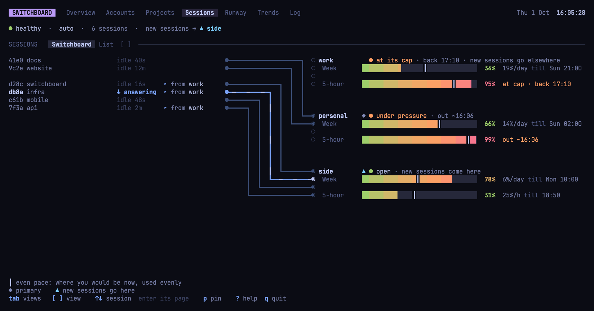

# Limits and routing: keep working when an account runs out

Switchboard sends each new session to the account whose quota most needs using. It keeps the
session there while the cache is warm, and moves it when that account hits a limit. The move
happens inside a single request, so Claude Code never stops. You'd want this as soon as you run
Claude Code on two accounts or more.

<p align="center"></p>

*The Sessions tab after work ran out of room: three of its sessions moved to side, marked `from work`.*

## Try it

```bash
# A new session: the router picks the account
claude
# The room on each account, and where new
# sessions go next
switchboard status
# Today's sessions, each with its account
switchboard sessions
# Today's starts, moves and limits
switchboard events
```

Every request from Claude Code passes through the router on your Mac. The router picks the
account, swaps in that account's token, and reads the usage off the answer:

```
claude ──▶ switchboard ──▶ Anthropic
               │
               ├─ picks the account
               ├─ swaps in its token
               ├─ reads the usage off the answer
               └─ on a limit, replays elsewhere
```

## What happens

- A new session goes to the account whose weekly quota is most at risk of going unused before it
  resets.
- The session stays on that account for an hour after its last request, while the account has
  room.
- After an hour idle, the cache has gone cold. The router then chooses again, and moves the
  session only if another account is well ahead.
- A request that hits a limit is sent again on another account before Claude Code sees the
  refusal, and the session carries on there.
- The account that hit the limit sits out until the reset that Anthropic gives, then takes new
  sessions again.
- When every account is out, Claude Code shows the usual limit message, the same one you'd see on a
  single account.

## Good to know

- A move costs a cold cache. A prompt cache belongs to one account, so the first turn after a move
  writes the whole conversation into a new cache. That turn is slower, and costs around 40 times a
  warm turn, which is why sessions stay put.
- A Claude Sonnet 5.5 session stays on its account however long it idles, because its earlier
  reasoning works only there. It moves only at a limit, a refusal or a pin.
- Two more rules spread the load. If the sessions on one account would use up its 5-hour window
  before it resets, new sessions go to another account. After Claude Code compacts a
  conversation, the session can move to an account whose week would otherwise reset with room
  unused.
- Nothing moves across a pool. If every account in a pool is out, work there waits for a reset,
  while other pools carry on.
- A pin overrides the router's choice until its account hits a limit.

## Reference

What the router does with each answer that refuses a request, its own reads of usage included:

| If Anthropic answers | The router |
|---|---|
| A limit is reached | Sends the request again on the best other account with room, and moves the session there. |
| Slow down, with no limit reached | Waits and tries the same account again, twice at most. |
| The token is refused (401) | Reads the token file again, and retries the same account once if the token changed. Otherwise it sends the request on another account, and the refused account sits out for ten minutes. |
| The request is refused (403) | Sends the request on another account. The refused account sits out that model family for ten minutes. |
| A read of usage is refused: the token (401), or the login of an ended subscription (403) | Sends nothing on that account until a read comes back clean. The account's sessions move, and Σ pool leaves out the account's room. See [Troubleshooting: an account's token or subscription](troubleshooting/tokens.md). |
| Too many requests, with no usage figures at all | Passes the refusal to Claude Code at once, unchanged. |
| No account has room | Reads any account that looks full once more, then gives Claude Code a limit refusal. |
| Every account refused the request | Answers 502 with the reason from Anthropic, and tells Claude Code not to retry. |

Every flag is in [Commands](commands.md), and the full rules for choosing an account are in
[Routing rules](reference/routing.md). If a session went somewhere you didn't expect, see
[Troubleshooting: the router](troubleshooting/router.md).

## Related

- [Pinning and moving](pinning-and-moving.md): send sessions to an account you choose.
- [Pools](pools.md): keep a set of accounts to the folders of one client.
- [Room for the Claude app](room-for-the-claude-app.md): keep part of an account out of routing.
