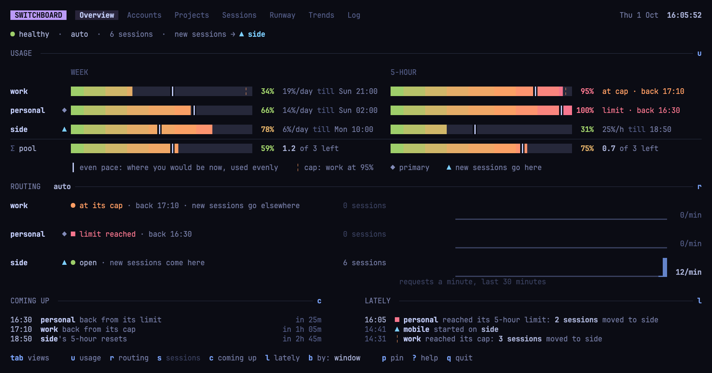

# Notifications: know when an account hits a limit or has room again

Switchboard posts a desktop notification when an account hits a limit, has room again, or passes
a share of a window you set. It also warns you a month before an account's token runs out. You'd
want them if you run sessions you aren't watching.

<p align="center"></p>

*A limit on the Overview: the same news a notification brings, with the sessions that moved.*

## Try it

Notifications for limits, room again and the warning at 90% are on from the start. To tune them,
add this to the config:

```toml
[notifications]
# an account hits a limit, and who moved off it
limits = true
# an account has room again
room = true
# warn when a window passes 80% of its limit;
# 0 turns the warning off
warning = 0.8
# every other session move, such as after
# an hour idle
moves = true
```

The router restarts itself to take up the change once no request is in flight. To restart it now,
run `switchboard service restart`.

## What happens

- When an account hits a limit, the notification waits 5 seconds for the sessions that move off
  it. Then it names them: `b6s7 · work hit its 5-hour limit, back at Mon 18:10 — 3 sessions moved
  to q4tx · side`.
- When the account can take requests again, you see `b6s7 · work has room again`.
- When a window passes the warning, you see `b6s7 · work: Week at 91%`, once until that window
  resets.
- When an account's token has 30 days left, you're told once, and again at 7 days. It reads
  `b6s7 · work: token expires 15 Dec 2026 · 30 days left — switchboard setup makes a new one`.
- With more than one pool, each notification starts with the pool, such as `Acme · k3f9 · Acme 1
  has room again`.
- Clicking a notification dismisses it. It opens nothing.

## Good to know

- macOS asks once whether `Switchboard` may send notifications. Notifications wait up to 5 minutes
  for your answer, and routing never waits.
- The token warnings always go out, whatever the config says. Each warning goes out once for each
  token. A restart doesn't repeat it, and a new token starts the count again.
- Only one notification goes out about an account each minute. A later one in that minute is
  dropped, unless it tells of a limit or a token.
- If the router isn't running, an open dashboard posts room again and the warning itself. Pass
  `--no-notify` to `switchboard dashboard` to stop that. While the router runs, the dashboard posts
  none, so you never get the same one twice.

## Reference

| Key in `[notifications]` | Default | What it turns on |
|---|---|---|
| `limits` | `true` | An account hits a limit, with the sessions the limit moved. |
| `room` | `true` | An account has room again. |
| `warning` | `0.9` | A window passes this share of its limit. `0` turns it off. |
| `moves` | `false` | Every other session move, such as after an hour idle or by a pin. |

If notifications don't show, or show as Script Editor, see
[Troubleshooting](troubleshooting/notifications.md). To turn them back on after you
turned them off, go to System Settings → Notifications → Switchboard. Every key is in
[Configuration](configuration.md).

## Related

- [Limits and routing](limits-and-routing.md): what a limit is, and how sessions move off one.
- [Pinning and moving](pinning-and-moving.md): the moves that `moves` tells you about.
- [Room for the Claude app](room-for-the-claude-app.md): keep a share of each window for yourself.
