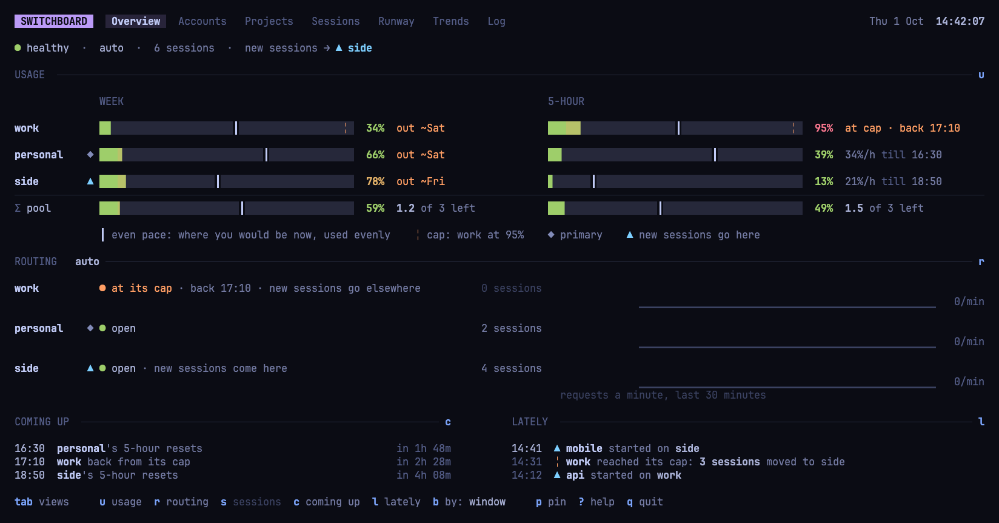

# Pinning and moving: choose the account your sessions use

A pin sends sessions to the account you choose, in place of the one the router would pick. Pin
new sessions to an account, move running sessions onto it, or pin a single session. You'd want
one to spend an account before its week resets, or to keep a long job on one account.

<p align="center"></p>

*The routing card pins new and running sessions to side, and the two sessions on personal move
there.*

## Try it

```bash
switchboard pin q4tx                 # new sessions go to side
switchboard pin q4tx --move          # and the running ones move there too, each on its next request
switchboard pin b6s7 --session 18bb  # pin one running session, by the start of its id
switchboard pin auto                 # back to routing
```

Name each account by the id that `switchboard accounts` lists. To find the id of a session, run
`switchboard status`, or `/status` inside Claude Code.

On the dashboard, press `p` to open the routing card. Pick an account with `space`, press `m` to
move the running sessions too, and press `enter` to apply. On the page of a running session, `p`
pins only that session.

Or ask Claude, for example "move this session to side" or "send new sessions to work". The
switchboard skill runs the same `pin` commands for it.

## What happens

- New sessions go to the pinned account while it has room. Sessions already running stay where
  they are, unless you pass `--move`.
- Pin several accounts, such as `pin b6s7 q4tx`, and new sessions go to the better of them until
  both are out.
- When every pinned account is out, the router picks among all the accounts in the pool as if
  nothing were pinned.
- A pinned session that hits a limit moves to another account, rather than fail.
- A pin of one session beats the pin of its pool. Add `--force` to clear those single-session
  pins as well.
- A pin stands until you change it, and through restarts of the router.

## Pins in a pool

Each pool has a pin of its own, and it steers only the sessions in that pool. When you pin an
account, the pin goes to the pool the account is in, so you don't name the pool. You can't pin
accounts of two pools at once, and you can't pin a session to an account outside its pool. When
every pinned account is out, the router picks among the accounts of that pool only.

`pin auto` needs to know which pool to clear. Without `--pool <id>`, it clears the only pool, or
else the unfenced pool. If every pool is fenced, it asks you for `--pool`. The folder you run it
in never chooses.

## Good to know

- A move costs a cold cache. Caches belong to one account, so the first turn after a move costs
  about 40 times a warm turn. The routing card shows the cost before you apply, such as `≈ $6.20`.
- A Claude Sonnet 5.5 session that moves carries on without its earlier reasoning, because that
  reasoning works only on the account that made it.
- A pin spends the reserve of the account it names. The router never spends a reserve, but a pin
  is your choice.
- `switchboard run --account <id>` pins a session from its start.

## Reference

| Command | What it does |
|---|---|
| `switchboard pin <id>...` | Sends new sessions in the pool of those accounts to them. |
| `switchboard pin <id> --move` | Also moves the running sessions there, each on its next request. |
| `switchboard pin <id> --move --force` | Moves every session in the pool, clearing their own pins. |
| `switchboard pin <id> --session <session>` | Pins one running session to one account. |
| `switchboard pin auto [--pool <id>]` | Goes back to routing in that pool. |
| `switchboard pin auto --session <session>` | Clears the pin of one session. |

Every flag is in [Commands](commands.md), and the routing card is in
[Dashboard](dashboard.md). If a pin is refused, see [Troubleshooting](troubleshooting.md).

## Related

- [Limits and routing](limits-and-routing.md): how the router picks an account, and why a session
  stays while its cache is warm.
- [Pools](pools.md): the fences that each pin keeps inside.
- [Room for the Claude app](room-for-the-claude-app.md): the reserve that a pin can spend.
