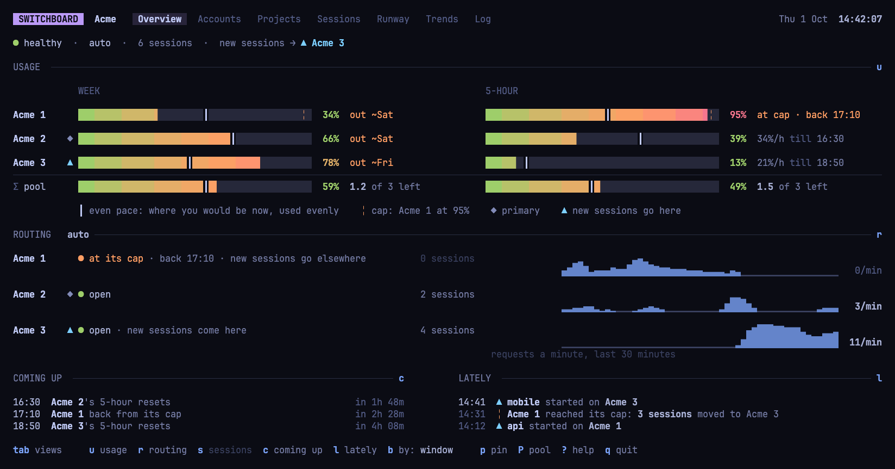

# Pools: ring-fence client work to its own accounts

A pool ring-fences a set of Claude accounts to folders you choose. Sessions started there use only
those accounts, and no other session touches them. You'd want one when a client gives you Claude
accounts for their work only, or when you keep an employer's account off your own projects.

<p align="center"></p>

*The dashboard in a client pool: the title row names Acme, and only the accounts of Acme show.*

## Try it

```bash
switchboard pool add Acme ~/Code/acme                    # a pool fenced to ~/Code/acme; it prints the new id, such as q7mt
switchboard accounts add "Acme 1" --pool q7mt --primary  # asks for the client's token, then adds the account to the pool as its primary
```

Then start `claude` anywhere under `~/Code/acme`, and it runs on the accounts of Acme. On the
dashboard, press `P` to turn from one pool to the next. The title row names the pool you're
looking at.

## What happens

- A session started anywhere under `~/Code/acme`, or in a git worktree of a repository there, uses
  only the accounts in Acme, wherever the worktree lives.
- Sessions started anywhere else use the unfenced pool, which holds the rest of your accounts.
- Inside a pool, a session keeps its account while the cache is warm, and moves when a limit hits.
- Each pool has a primary: the account that sessions there start on, and send artifacts and
  uploads from.
- When every account in a pool is out, work there waits for a reset rather than spill onto the
  accounts of another pool.
- The dashboard shows one pool at a time, and every request is recorded under the pool it ran in.

## Good to know

- A session keeps the pool it started in. If you fence a folder while a session runs there, exit
  and resume the session to bring it into the new pool. A session resumed in the folder of another
  pool starts afresh there, and any old process still running keeps the old pool.
- A new account starts taking sessions once the router restarts. The service restarts it by itself
  once no request is in flight, and `switchboard service restart` does it at once.
- Fences can't overlap: two pools can't share a folder, or hold one inside the other. A fence
  covers whole folder names, so `~/Code/acme` doesn't cover `~/Code/acme-api`.
- Only one pool can be unfenced. If every pool is fenced, `claude` won't start outside every
  fence. Nor will it start inside the fence of a pool with no accounts.
- `switchboard run --direct` is refused inside a fence. It would start Claude Code on whichever
  account Claude Code itself is signed into, which may not be one of the pool.

## Reference

| Command | What it does |
|---|---|
| `switchboard pool` | Lists the pools, with their ids, folders and accounts. |
| `switchboard pool add <label> [<dir>...]` | Makes a pool fenced to the folders given. With no folders, it's the unfenced pool. |
| `switchboard pool edit <id> --label <label>` | Renames a pool. |
| `switchboard pool edit <id> --dirs <dir>` | Fences a pool to new folders in place of the old ones, one `--dirs` for each folder. |
| `switchboard pool edit <id> --unfence` | Takes the fence away, making it the unfenced pool. |
| `switchboard pool remove <id>` | Removes an empty pool. Its history stays, read with `--pool <id>`. |
| `switchboard accounts edit <id> --pool <id>` | Moves an account into another pool. |

Every flag is in [Commands](commands.md), and the `[[pool]]` keys are in
[Configuration](configuration.md). If `claude` won't start in a folder, or a request is refused
inside a pool, see [Troubleshooting](troubleshooting.md).

## Related

- [Glossary](glossary.md): what pool, fence, primary and the other terms mean.
- [Dashboard](dashboard.md): what each tab shows inside a pool.
- [How it works](how-it-works.md): how switchboard routes and records.
