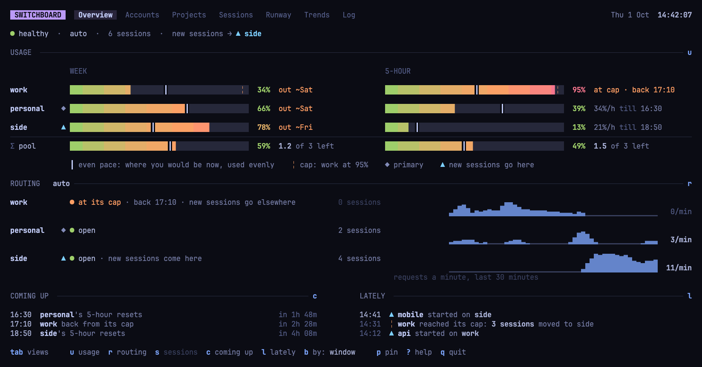

# Room for the Claude app: keep part of an account for yourself

A reserve sets aside a share of every window on an account. The router doesn't choose that share
for your sessions, so it stays free for the Claude app, claude.ai and anything else outside
switchboard. Set one on the account your Claude app is signed into. Without a reserve, the router
runs every account up to its limit.

<p align="center"></p>

*The Overview with work at its cap: new sessions go elsewhere, and its three sessions moved to side.*

## Try it

```bash
# Each account, and which is the primary
switchboard accounts
# Make work the primary
switchboard accounts edit b6s7 --primary
# Keep 5% of every window on work
switchboard accounts edit b6s7 --reserve 5%
```

With a reserve of 5%, the cap is at 95%, where work stands in the still above. Once any window on
the account reaches 95%, the router stops choosing it. The router restarts itself to take up the
change once no request is in flight. To restart it now, run `switchboard service restart`.

Make the [primary](glossary.md) the account your browser and the Claude app are signed into.
Claude Code sends artifacts and uploads on the primary's token, so they open in that browser. The
conversation itself still goes wherever the router sends it. A reserve works on any account, but
the primary is where you'll usually want one.

## What happens

- Once a window on the account reaches the cap, new sessions skip the account, and sessions on it
  move as they would at a limit.
- When the router compares accounts, it counts only the room below each cap.
- The dashboard marks each cap on the bars with `╎`, and shows `at its cap` with the time the
  account is back.
- When the window resets, the account takes sessions again.
- If only reserved room is left, the router leaves it alone, and Claude Code gets a limit refusal
  from switchboard.
- The Claude app can still use the reserved room, and take the account past its cap, as intended.

## Good to know

- A pin spends the reserve, because a pin is your choice rather than the router's. If every other
  account is out and you need the room, run `switchboard pin b6s7 --move`. To hand the sessions
  back to the router, run `switchboard pin auto`.
- The router reads usage off each answer, so one large turn can go a point or two past the cap
  before the router sees it.
- A session that bypasses the router can spend the reserve. That covers `switchboard run --direct`,
  and every session started while the router is down if you set `when_router_down = "direct"`.
- With pools, each pool has a primary of its own, and sessions in a pool send artifacts on that
  primary. What this page says of your browser and the Claude app holds for the first pool's
  primary.

## Reference

| Setting or command | What it does |
|---|---|
| `reserve = 0.05` | In the account's `[[account]]` table, keeps 5% of every window. The default is `0`. |
| `accounts edit <id> --reserve 5%` | Sets the reserve as a percentage. `0%` takes it away. |
| `primary = true` | In the account's `[[account]]` table, makes it the primary of its pool. |
| `accounts edit <id> --primary` | Makes the account the primary, in place of the one that was. |

The `[[account]]` keys are in [Configuration](configuration.md), and every flag is in
[Commands](commands.md).

## Related

- [Limits and routing](limits-and-routing.md): how the router picks an account and moves a session.
- [Pinning and moving](pinning-and-moving.md): send sessions to an account you choose.
- [Glossary](glossary.md): what reserve, cap, primary and room mean.
