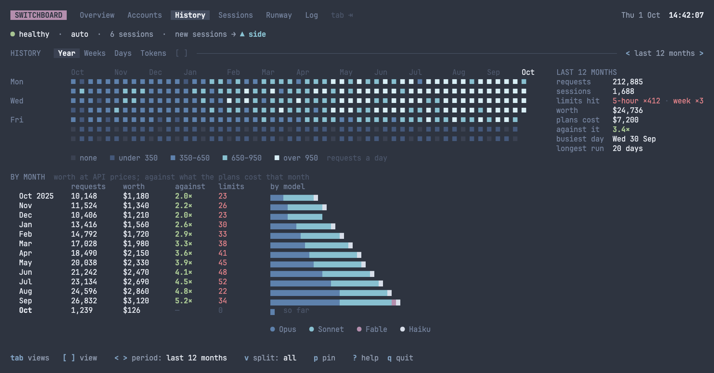

# Your record: every request, and what it was worth

Switchboard records every request the router handles, but never its content. From that record you
can look back over a year of sessions, tokens and limits. You can also see what your use would have
cost at API prices, against what your plans cost. You'd look when you wonder whether a plan pays
for itself, or where a week went.

<p align="center"></p>

*History on the dashboard: a year of 212,885 requests, worth $24,736 at API prices, against $7,200
of plans.*

## Try it

```bash
# The last 30 days, priced against each plan
switchboard history
# Today's sessions, with their requests and worth
switchboard sessions
# Every request since 14:00, one line each
switchboard requests --since 14:00
# Then press tab for History, Sessions or the Log
switchboard dashboard
```

The first three don't need the router, because they read the record from its files.

## What happens

- The router writes a line for each request as the request finishes, into a file a day.
- A line holds:
  - the session, the folder and the model;
  - the account, and why the request went there;
  - the timing, size and settings of the request;
  - the usage the answer gave, and the names of the tools it called.
- A line never holds a prompt or a reply. It counts the messages and tools a request carries, but
  holds none of their text, and none of what Claude writes back.
- The router also records each change in the use of a window. It records its own events too, such
  as a move or a limit.
- An hour after each day ends, the router writes a summary of the day, which is kept for good.
- Worth is priced at the API prices switchboard carries, read from Anthropic's pricing page.
  Plan cost comes from the `plan` you give each account.

## Good to know

- The record lives in `~/.local/state/switchboard/`. Requests go in `ledger/`, and readings of the
  windows in `history/`.
- Day files are kept for 400 days. Set `keep` under `[ledger]` or `[history]` to a number of days,
  `8d` or more, or to `forever`. The daily summaries stay whatever `keep` says.
- The record holds the requests this Mac routed, and any you import from another Mac. Use from the
  Claude apps shows in the limits, but not in the tokens, worth or sessions.
- A model with no known price shows as unpriced, never free. An account without a `plan` has no
  cost to set its worth against.

## Reference

| Key | Default | What it sets |
|---|---|---|
| `[ledger] keep` | `400d` | How long to keep the request lines and the router's events. |
| `[history] keep` | `400d` | How long to keep the readings of each window. |
| `plan`, on an account | None | The plan, `pro`, `max` or `ultra`, which prices the account. |
| `[prices.plans]` | Switchboard's prices | Your own price for a plan, in US dollars a month. |
| `[prices.models.<id>]` | Switchboard's prices | Your own prices for a model, in US dollars a million tokens. |
| `[export] dir` | None | A folder the router exports the record into every hour. |

Every flag of `history`, `sessions`, `requests` and `events` is in [Commands](commands.md). Every
key is in [Configuration](configuration.md), and the file formats are in [Reference](reference.md).
If an export fails, see [Troubleshooting](troubleshooting/exports.md).

## Related

- [Several Macs](several-macs.md): export the record, and import it on another Mac.
- [Dashboard](dashboard.md): what History, Sessions and the Log show.
- [Claude and switchboard](claude-and-switchboard.md): how Claude reads the record for you.
